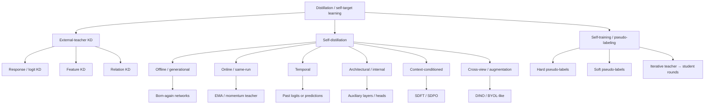
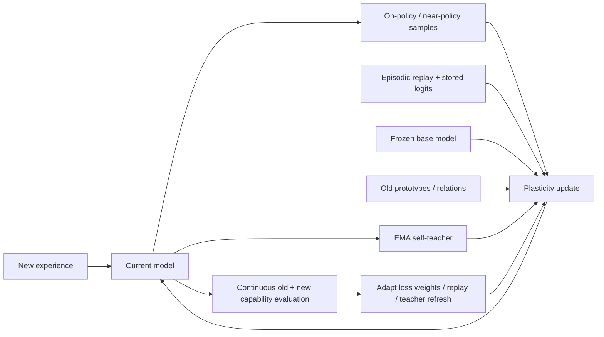

# Self-Distillation and Continual Learning: How Close Are We?

[Citations didn't export.]

## Executive summary

**Bottom line:** as of October 14, 2026, self-distillation is bringing machine learning materially closer to practical continual learning, but the evidence does **not** support the stronger claim that self-distillation, by itself, solves continual learning. The most convincing interpretation of the last several years is that self-distillation has become a powerful **function-space stability mechanism and data-distribution control mechanism**: it can tell a changing model *how much of its previous behavior to preserve, on which states or inputs, and in what representation space*. It works particularly well when combined with replay, prototype constraints, an exponential-moving-average teacher, in-distribution self-generated data, or an immutable base-model anchor. 

The important conceptual change is that recent work is moving beyond the old picture of knowledge distillation—“train a small student to imitate a large, frozen teacher”—toward **self-referential learning systems whose teacher is another temporal, contextual, architectural, or augmented view of the learner itself**. DINO uses a momentum teacher to teach another view of the same model; BYOL predicts a slowly moving target representation; Dark Experience Replay preserves logits sampled from the model’s own history; MOSE distills shallow internal experts into the full network; recent language-model methods condition a copy of the current model on demonstrations or feedback and distill that privileged behavior back into the unconditioned policy. 

That matters for catastrophic forgetting because a large class of continual-learning algorithms can be written as:

$$
\boxed{
\mathcal L_t(\theta)
=
\mathcal L_{\text{plasticity},t}(\theta)
+
\lambda
\underbrace{
\mathbb E_{x\sim \mu_t}
D\!\left(q_t(\cdot|x)\,\|\,p_\theta(\cdot|x)\right)
}_{\text{stability / distillation term}}
}
$$

where $q_t$ is some representation of previous or privileged behavior and $\mu_t$ determines **where** that behavior is preserved. LwF uses the old network as $q_t$ but evaluates it mainly on current-task inputs; DER puts old inputs *and old logits* into $\mu_t$; EMA self-distillation makes $q_t$ a recent temporal ensemble; on-policy LM self-distillation chooses $\mu_t$ from the learner's current trajectory distribution. This “**teacher × support**” decomposition explains why some self-distillation schemes are dramatically better continual learners than others. 

The strongest positive evidence is now fairly diverse. In conventional vision continual learning, DER/DER++ showed that replaying a model's own historical “dark” logits can greatly outperform ordinary experience replay under tight memory budgets; MOSE's reverse self-distillation improves online CIFAR-100 performance and measurably reduces average forgetting; replay-free Prototype-Sample Relation Distillation preserves relational geometry without storing old images.  In language-model post-training, the 2024 SDFT work found self-rewritten targets substantially reduced collateral capability losses, and 2026 SDFT work reported sequential skill acquisition with far less prior-capability degradation than ordinary SFT. 

There is also now unusually strong evidence for **why** this may happen. *Retaining by Doing* found across Qwen and Llama models that on-policy or approximately on-policy data was a much stronger explanation of low forgetting than either explicit KL-to-base regularization or GRPO's particular advantage estimator; epoch-level iterative generation was already sufficient to greatly reduce forgetting relative to fully off-policy SFT.  This supports the central intuition behind modern on-policy self-distillation: **learning on states the present model actually visits can reduce unnecessary distributional displacement.**

But 2026 also produced the most important counterevidence. *Denser $\neq$ Better* finds that token-dense on-policy self-distillation can produce **more** forgetting than conservative sequence-level RL, amplify formatting artifacts, and even collapse during sequential post-training; its conclusion is explicitly that on-policy data alone does not guarantee retention.  SDFT also degrades at small model scales because the model becomes an inadequate teacher; a paper posted only five days ago, *Continually Post-training Small Models via Synthetic Self-distillation*, responds by using a minimally larger same-family model to generate distribution-matched targets rather than insisting on literal self-teaching. 

So the evidence supports a more precise conclusion:

> **Self-distillation is becoming an important substrate for continual learning, not a replacement for continual-learning machinery.** Its contribution is strongest when it controls functional drift, preserves useful relational structure, or keeps updates close to the model's own distribution. It does not, by itself, guarantee coverage of forgotten tasks, reliable teachers, bounded long-horizon drift, or allocation of fresh capacity.

The field therefore appears closer to a hybrid architecture in which **replay or pseudo-replay provides coverage, self-distillation provides functional stability, on-policy generation controls distribution shift, frozen anchors prevent accumulated drift, and modular/parameter-isolation mechanisms provide capacity**. The emerging 2026 literature makes that synthesis more plausible—not less—because it is beginning to identify exactly when self-distillation succeeds and exactly when it fails. 


## Technical foundations and taxonomy

Knowledge distillation is easiest to understand by separating four questions: **Who is the teacher? When is the teacher produced? On which data does the student imitate it? What quantity is distilled?**

For a conventional classifier with teacher logits $z_T$, student logits $z_S$, temperature $\tau$, and

$$
p_T^\tau(k|x)
=
\frac{\exp(z_{T,k}/\tau)}
     {\sum_j \exp(z_{T,j}/\tau)},
\qquad
p_S^\tau(k|x)
=
\frac{\exp(z_{S,k}/\tau)}
     {\sum_j \exp(z_{S,j}/\tau)},
$$

the classical response-level KD objective is typically written

$$
\mathcal L_{\mathrm{KD}}
=
(1-\alpha)\,
\operatorname{CE}(y,p_S)
+
\alpha\tau^2
D_{\mathrm{KL}}
\!\left(
p_T^\tau\,\|\,p_S^\tau
\right).
$$

The softened teacher distribution transmits information not contained in the hard class label: relative probabilities among non-target classes. This is the original “dark knowledge” picture of distillation. 

**Self-distillation** is best given a broad but precise definition: *the supervisory target is produced by the same underlying learner, model family, training trajectory, or representation hierarchy rather than by a separately trained, permanently external expert*. Different papers draw the boundary differently, so “self-distillation,” “teacher-free KD,” “self-training,” and “bootstrapping” overlap but are not synonyms. DINO explicitly describes itself as “self-distillation with no labels,” while BYOL calls its branches online and target networks rather than teacher and student; both nevertheless instantiate the same slowly moving self-target idea. 



This taxonomy combines the distinctions made operationally by born-again training, temporal/EMA teachers, DINO/BYOL-style self-supervision, iterative self-training, and current on-policy LM distillation. 

| Variant | Teacher or target | Schedule | Typical loss | Relationship to continual learning |
|---|---|---|---|---|
| **Offline classical KD** | Separately trained fixed teacher | Train teacher, freeze, then student | CE + softened-logit KL | Functional regularizer, but teacher is not adapting.  |
| **Born-again self-distillation** | Previous generation of same/similar architecture | $M_0\to M_1\to M_2\ldots$, predecessor frozen | KD/soft-target CE | Temporal transfer across complete training runs; an early prototype of “past self as teacher.”  |
| **Online self-distillation** | Concurrent branch, peer, or momentum copy | Student and target evolve during one run | KL, CE, cosine or feature regression | Provides a moving proximal target; protects recent behavior rather than arbitrary old-task support.  |
| **EMA / Mean Teacher** | Weight-averaged student history | Teacher updated every step | Consistency KL/MSE | Low-pass filter on parameter trajectory; strong short-timescale stability.  |
| **Temporal ensembling** | EMA of *predictions* for each example | Targets aggregated across epochs | Prediction consistency | Preserves temporal consensus without a separate teacher network, at $O(NC)$ target-memory cost.  |
| **Feature self-distillation** | Deeper/shallower layers or auxiliary heads | Usually same forward pass | $\ell_2$, cosine, contrastive | Constrains representation drift. MOSE is a CL-specific recent example.  |
| **Relation self-distillation** | Pairwise/prototype geometry | Same or previous model | KL/CE over similarity distributions | Can preserve old geometry without exact logits or raw exemplars.  |
| **Teacher-free KD** | No separately pretrained external teacher; target may come from labels, branches, snapshots, augmentations or context | Varies | Label-derived or self-derived soft targets | Umbrella category; only some forms provide temporal memory. DINO is explicitly external-teacher-free.  |
| **Self-training** | Earlier model creates labels on unlabeled data | Generate pseudo-labels → retrain → optionally repeat | Hard-label CE or soft-target KD | Primarily expands training support; becomes a CL mechanism when pseudo-data acts as rehearsal. Noisy Student is the canonical iterative example.  |
| **On-policy distillation** | Teacher evaluates student-generated trajectories | Regenerate as policy changes | Token/sequence KL | Reduces student/teacher state-distribution mismatch; central to recent LM work.  |
| **Context-conditioned self-teacher** | Same LM receives privileged demonstration/feedback; student does not | Offline rewrite or online rollout | NLL or KL | Transfers information while trying to stay in the model's native output distribution.  |

### Core mechanisms

An **EMA teacher** replaces a completely frozen teacher with a smoothed history of the student:

$$
\phi_t
=
m\phi_{t-1}
+
(1-m)\theta_t,
\qquad 0\le m<1,
$$

with gradients stopped through $\phi_t$. A typical consistency objective is

$$
\mathcal L_{\mathrm{cons}}
=
D\!\left(
p_{\phi_t}(\cdot|a_1(x)),
p_{\theta_t}(\cdot|a_2(x))
\right).
$$

Mean Teacher pioneered the weight-EMA formulation; DINO later combined a momentum teacher with different image views, multi-crop training, centering and sharpened teacher distributions; BYOL uses a moving target network and normalized representation prediction. 

**Temporal ensembling** instead stores an EMA of predictions:

$$
Z_i^{(t)}
=
\alpha Z_i^{(t-1)}
+
(1-\alpha)p_{\theta_t}(x_i),
\qquad
\tilde Z_i^{(t)}
=
\frac{Z_i^{(t)}}{1-\alpha^t},
$$

and minimizes a consistency discrepancy such as

$$
\mathcal L_{\mathrm{TE}}
=
\sum_i
\left\|
p_{\theta_t}(a(x_i))
-
\tilde Z_i^{(t)}
\right\|_2^2.
$$

This is self-distillation through a **prediction-history memory** rather than a network-history memory. 

In **pseudo-label self-training**, a teacher generates

$$
\hat y(x)
=
\arg\max_k p_T(k|x),
\qquad
\text{accept if } \max_k p_T(k|x)>\gamma,
$$

or retains the complete soft distribution $p_T$. The student then minimizes

$$
\mathcal L_{\text{pseudo}}
=
-\mathbb E_{x\sim U_{\gamma}}
\log p_\theta(\hat y(x)|x).
$$

Noisy Student combines this with augmentation, dropout and stochastic depth in the student, allows an equal-sized or larger student, and iterates student-to-teacher promotion; it reached 88.4% ImageNet top-1 in its original large-scale experiment.  Self-training therefore differs from self-distillation in emphasis: **self-training manufactures training data; self-distillation transfers a distribution or representation.** A method can do both.

For **feature distillation**,

$$
\mathcal L_{\text{feat}}
=
\left\|
g(h_S(x))-h_T(x)
\right\|_2^2,
$$

while relation distillation can preserve pairwise geometry,

$$
r_{ij}^{T}
=
\frac{
\exp(s(h_i^T,h_j^T)/\tau)
}{
\sum_{k\neq i}\exp(s(h_i^T,h_k^T)/\tau)
},
\qquad
\mathcal L_{\text{rel}}
=
\sum_i
D_{\mathrm{KL}}(r_i^T\|r_i^S).
$$

Those losses are particularly relevant to continual learning because class identities may change while **relative geometry remains reusable**. Prototype-Sample Relation Distillation explicitly exploits this principle without storing prior-task datapoints. 


## A unified mathematical view of distillation and forgetting

Suppose tasks or distributions arrive sequentially,

$$
\mathcal D_1,\mathcal D_2,\ldots,\mathcal D_T,
$$

and $R_{i,j}$ denotes performance on task $j$ after learning through task $i$. A standard end-of-stream accuracy is

$$
\mathrm{ACC}
=
\frac1T\sum_{j=1}^{T}R_{T,j}.
$$

A useful forgetting measure is

$$
F_j
=
\max_{i<T}R_{i,j}
-
R_{T,j},
\qquad
\mathrm{AF}
=
\frac1{T-1}\sum_{j<T}F_j.
$$

Backward transfer can be written

$$
\mathrm{BWT}
=
\frac1{T-1}
\sum_{j<T}
(R_{T,j}-R_{j,j}),
$$

so negative BWT corresponds closely, though not identically, to forgetting. Forward transfer compares performance on a not-yet-trained task against an untrained/reference baseline. Exact metric conventions vary between CL papers; MOSE, for example, explicitly reports both average accuracy and average forgetting. 

The generic stability–plasticity problem is

$$
\min_\theta
\underbrace{
\mathbb E_{(x,y)\sim\mathcal D_t}
\ell(y,f_\theta(x))
}_{\text{learn new distribution}}
+
\lambda
\underbrace{
\mathcal R_t(\theta)
}_{\text{preserve old competence}}.
$$

Traditional continual-learning families differ primarily in how they instantiate $\mathcal R_t$.

**Parameter regularization**, as in Elastic Weight Consolidation, penalizes movement of parameters estimated to matter to past tasks:

$$
\mathcal R_{\mathrm{EWC}}
=
\frac12
\sum_i
F_i
(\theta_i-\theta_i^\star)^2,
$$

where $F_i$ approximates parameter importance using diagonal Fisher information. 

**Functional regularization via distillation** instead constrains outputs:

$$
\mathcal R_{\mathrm{func}}
=
\mathbb E_{x\sim\mu_t}
D_{\mathrm{KL}}
\left[
p_{\theta_{\rm old}}(\cdot|x)
\|
p_{\theta}(\cdot|x)
\right].
$$

Learning without Forgetting is the classic example: an old network supervises the updated one even when original old-task training data are unavailable. 

For small parameter movements $\Delta\theta$, output-space KL has the local approximation

$$
D_{\mathrm{KL}}
\left(
p_\theta\|p_{\theta+\Delta\theta}
\right)
\approx
\frac12
\Delta\theta^\top
F_x
\Delta\theta,
$$

where $F_x$ is the model's local Fisher metric. This makes output self-distillation a function-space analogue of EWC: EWC preselects a parameter-space metric, whereas distillation asks which parameter changes alter **behavior on selected inputs**.

The phrase “selected inputs” is crucial. Consider

$$
\boxed{
\mathcal R_{\rm SD}
=
\mathbb E_{x\sim\mu}
D(q(\cdot|x),p_\theta(\cdot|x))
}
$$

and separate the two design variables:

$$
\textbf{teacher target }q
\quad\times\quad
\textbf{support distribution }\mu.
$$

This yields a useful explanation of the literature:

* LwF has a reasonably faithful old teacher $q$, but $\mu$ is mostly current-task data. Old behavior is only protected where the current and old input supports overlap. 
* DER has both old self-targets $q$ **and old inputs in $\mu$** because it stores historical $(x,z)$ pairs. This is why “distillation + replay” is fundamentally stronger than distillation on new inputs alone. 
* EMA methods have a very fresh $q$ but only short temporal memory. Without replay or a frozen anchor they can faithfully preserve yesterday while slowly forgetting six months ago.
* On-policy distillation changes $\mu$: supervision is applied to prefixes or trajectories sampled by the current student, reducing the mismatch between training states and the states encountered at inference. 
* Context-conditioned self-distillation changes $q$: the teacher is the same model under a more informative context, so the desired new behavior can remain much closer to the base model's own representational/output distribution. 

That last case is mathematically distinctive. In 2026 SDFT, let

$$
P_\theta(y|x)=\pi_\theta(y|x)
$$

be the student and

$$
Q_\phi(y|x,c)=\pi_\phi(y|x,c)
$$

the same model conditioned additionally on a demonstration $c$. One motivating objective is reverse KL:

$$
\mathcal L_{\rm SDFT}
=
D_{\mathrm{KL}}(P_\theta\|Q_\phi)
=
\mathbb E_{y\sim P_\theta}
\left[
\log
\frac{P_\theta(y|x)}
     {Q_\phi(y|x,c)}
\right].
$$

Crucially, $y$ is drawn from the **student**, so the teacher evaluates states induced by the current policy rather than only teacher-generated trajectories. The paper uses an EMA teacher in practice and reports that its forward-KL version performs best empirically despite reverse KL motivating the analysis. 

Its algorithm is approximately:

```mermaid
flowchart LR
    X[Prompt x] --> S[Student πθ]
    S --> Y[Sample on-policy response y]
    Y --> PS[Student token distributions]

    C[Demonstration c] --> T[Context-conditioned teacher πφ]
    X --> T
    Y --> T
    T --> PT[Teacher distributions on same prefixes]

    PS --> KL[Token-level distillation loss]
    PT --> KL
    KL --> UP[Update θ]
    UP --> EMA[φ ← αθ + (1-α)φ]
    EMA --> T
```

Thus the state distribution follows the student while the target distribution comes from a privileged, demonstration-conditioned version of essentially the same model. 

The inverse-RL interpretation in that paper makes the connection to conservative continual adaptation particularly clear. A trust-region update

$$
\pi_{k+1}
=
\arg\max_\pi
\left[
\mathbb E_{\pi}r
-
\beta D_{\rm KL}(\pi\|\pi_k)
\right]
$$

has the exponentially tilted solution

$$
\pi_{k+1}(y|x)
\propto
\pi_k(y|x)
\exp\!\left(\frac{r(x,y)}{\beta}\right).
$$

If the demonstration-conditioned model approximates the desired improved policy, then a token log-ratio such as

$$
r_t
\simeq
\log \pi(y_t|x,c,y_{<t})
-
\log \pi_k(y_t|x,y_{<t})
$$

acts as an implicit dense reward. In other words, modern self-distillation is beginning to look less like model compression and more like a **proximal policy-improvement operator**. 

Information-Proximal SDFT makes that idea explicit. It starts with student $P_t$ and self-teacher $T_t$, defines the teacher information supplied by a candidate target $Q$,

$$
I_t(Q)
=
\mathbb E_{v\sim Q}
\left[
\log\frac{T_t(v)}{P_t(v)}
\right],
$$

and finds the least disruptive target satisfying an information budget,

$$
Q_t^\star
=
\arg\min_Q D_{\rm KL}(Q\|P_t)
\quad
\text{s.t.}
\quad
I_t(Q)\ge\gamma_t.
$$

The solution follows an exponential path,

$$
Q_t^\star(v)
\propto
P_t(v)^{1-\lambda_t}
T_t(v)^{\lambda_t},
$$

and the learner is additionally anchored to a frozen base distribution $P_{\rm base}$,

$$
\ell_t
=
D_{\rm KL}(Q_t^\star\|P_t)
+
\mu D_{\rm KL}(P_{\rm base}\|P_t).
$$

That is almost a direct mathematical statement of the continual-learning stability–plasticity tradeoff: **take only as much new information from the moving self-teacher as necessary, while maintaining a permanent reference to the original model.** The 2026 preprint reports better results than vanilla SDFT in seven of eight tested settings and retention within 0.5 points of the base model on 73% of evaluations versus 52% for its strongest baseline. 


## How self-distillation maps onto continual-learning paradigms

The most useful conclusion from the equations above is that self-distillation is not really a fifth mutually exclusive continual-learning paradigm. It cuts **across** the established paradigms.

| Continual-learning paradigm | Canonical idea | Where self-distillation fits | What it protects against | Fundamental remaining weakness |
|---|---|---|---|---|
| **Regularization-based** | Penalize destructive updates; EWC constrains important parameters.  | LwF/self-distillation replaces parameter distance with functional distance to an old/self teacher.  | Output drift on inputs covered by the distillation distribution | No constraint on old regions that are never revisited |
| **Replay/rehearsal** | Mix old and new examples | DER stores the model's own historical logits with replay inputs; DER++ adds hard-label replay.  | Both support drift and function drift | Memory/privacy/storage; sampling strategy |
| **Generative / pseudo-replay** | Reconstruct old-like inputs instead of storing originals | Self-training or generative self-distillation can generate pseudo-old samples and teacher targets | Extends old-task support without raw data | Generator itself can forget or hallucinate |
| **Parameter isolation / modularity** | Freeze or allocate parameters per task | Distillation can transfer expertise from isolated modules back to a shared model; PackNet itself avoids forgetting by reserving parameters.  | Parameter interference | Capacity grows or becomes exhausted; task routing may be required |
| **Meta-learning / gradient shaping** | Learn updates that transfer and interfere less | Distillation supplies an auxiliary gradient whose alignment with past behavior can be optimized/meta-learned | Inter-task gradient interference | Higher-order/optimization cost; does not guarantee old support coverage |
| **Prototype / representation CL** | Preserve class geometry rather than every example | PRD and internal self-distillation constrain similarities or prototypes.  | Representation rotation and class-geometry collapse | May not preserve fine-grained instance behavior |
| **On-policy continual adaptation** | Train on the model's current state/trajectory distribution | SDFT/SDPO use privileged copies of the current learner to supervise its own sampled trajectories.  | Off-policy mismatch and unnecessarily broad parameter/output drift | Self-teacher errors and no guarantee of old-task coverage |

A particularly important historical bridge is **Dark Experience Replay**. DER stores an example $x$ together with the logits $z=h_{\theta_{\rm past}}(x)$ produced when that example entered the reservoir. Its loss is

$$
\mathcal L_{\rm DER}
=
\mathcal L_t
+
\alpha
\mathbb E_{(x,z)\sim\mathcal M}
\left\|
z-h_\theta(x)
\right\|_2^2.
$$

DER++ adds hard-label replay:

$$
\mathcal L_{\rm DER++}
=
\mathcal L_t
+
\alpha
\mathbb E_\mathcal M
\left\|z-h_\theta(x)\right\|_2^2
+
\beta
\mathbb E_\mathcal M
\ell(y,f_\theta(x)).
$$

The reservoir therefore serves simultaneously as **episodic memory and a sparse record of the network's former function**. 

On Sequential CIFAR-10 with a buffer of only 200 samples, ordinary experience replay obtained 44.79% Class-IL accuracy, while DER reached 61.93% and DER++ 64.88%; on Permuted MNIST, ER achieved 72.37%, DER 81.74% and DER++ 83.58% in the reported configuration. The authors also found DER/DER++ produced flatter minima and better calibration than ordinary replay.  This is arguably some of the clearest evidence that **preserving one's own old soft behavior can add information beyond merely preserving old examples**.

MOSE provides a different connection. It divides a network into sequential internal experts and applies multi-level cross-entropy/contrastive supervision. Shallower experts then act as detached teachers for the deepest expert:

$$
\mathcal L_{\rm RSD}
=
\mathbb E_{x}
\sum_{i=1}^{n-1}
\left\|
\operatorname{norm}(\operatorname{sg}(h_i))
-
\operatorname{norm}(h_n)
\right\|_2,
$$

with

$$
\mathcal L_{\rm MOSE}
=
\mathcal L_{\rm MLS}
+
\mathcal L_{\rm RSD}.
$$

This “reverse self-distillation” aggregates complementary internal expertise into the deployable full model. 

Its Split CIFAR-100 experiment is useful because it reports **forgetting directly**:

```text
Average forgetting, Split CIFAR-100, memory = 5k   lower is better

SCR + CE             45.8  ██████████████████████████████████████████████
+ multi-level sup.   39.1  ███████████████████████████████████████
+ MLS + RSD          36.9  █████████████████████████████████████████

Total reduction from baseline: 8.9 points
Marginal reduction from adding reverse self-distillation to MLS: 2.2 points
```

The corresponding average accuracy rose from 22.3% to 31.6% with multi-level supervision and to 35.1% when reverse self-distillation was added. Training time increased from 8.8 minutes for the baseline to 17.5 minutes with both components, so the benefit is real but not computationally free. 

Another instructive case is the 2024 online class-incremental method of Nagata et al., which combines replay with a self-distillation loss over sample-to-sample similarity distributions between shallow and deep representations. On the smallest buffers tested, it improved over the strongest SCR baseline by about 5.9 points on Split CIFAR-10, 3.2 on CIFAR-100 and 4.0 on MiniImageNet. Its ablations are revealing, however: on CIFAR-100 and MiniImageNet much of the improvement comes from the buffer-management component, while self-distillation supplies a smaller incremental gain. 

That result captures the broader theme: **self-distillation usually strengthens a continual learner more reliably than it substitutes for memory.**


## Evidence from recent primary research

The table below emphasizes work since roughly 2021, while retaining several older foundations needed to interpret the newer results.

| Work | Distillation mechanism and training schedule | Architecture / data | Main empirical observation | Relevance to continual learning |
|---|---|---|---|---|
| **DINO, 2021** | Online self-distillation; student matches a momentum/EMA teacher across augmented views; no class labels | ViTs, ImageNet | Small ViT reaches 78.3% ImageNet k-NN top-1; ViT-B reaches 80.1% linear-eval top-1.  | Establishes that a moving self-teacher can learn stable, semantically structured representations without an external teacher; not itself a CL algorithm |
| **Self-distilled Knowledge Delegator, 2022** | Data-free self-distillation constructs a knowledge delegator/generative surrogate for old knowledge | Class-incremental vision; CIFAR-100, ImageNet subset, Caltech-101, Flowers-102 | Reports large improvements over exemplar-free alternatives and competitiveness with some exemplar-based approaches.  | Early evidence that self-distillation can help manufacture a substitute for unavailable old data |
| **Prototype-Sample Relation Distillation, ICML 2023** | Replay-free distillation of relative prototype-to-new-sample similarities; supervised contrastive representation learning | Class/task incremental vision | Reports state-of-the-art task-incremental results and strong class-incremental results without stored datapoints.  | Demonstrates that retaining **relations** rather than raw instances can preserve old prototypes |
| **On-Policy Distillation of Language Models, ICLR 2024** | Student samples its own trajectories; teacher supervises errors on those student-visited states | Autoregressive LMs | Establishes on-policy distillation as an alternative to purely teacher-generated/off-policy KD.  | Key technical precursor to 2026 continual-learning SDFT: moves the distillation support distribution toward inference-time states |
| **Yang et al., ACL 2024, SDFT** | Fixed seed model rewrites demonstrations into model-native targets; then conventional NLL fine-tuning | Primarily Llama-2-7B-chat + LoRA; OpenFunctions, GSM8K, MagiCoder/HumanEval | OpenFunctions fine-tuning: vanilla FT average 22.0 versus self-distilled FT 27.0 across OpenFunctions/GSM8K/HumanEval; old capabilities degrade much less.  | Shows that **offline** self-generated targets can reduce the distribution gap responsible for collateral forgetting |
| **MOSE, CVPR 2024** | Multi-level internal experts + reverse feature self-distillation + replay | Online Split CIFAR-100 and Split Tiny-ImageNet | At CIFAR-100 $M=5k$, MOSE gives 54.8% ACC / 13.5% AF in its main table versus 49.7/8.7 for GSA; the RSD ablation raises ACC from 52.29 to 54.57. Small-buffer gains reach >5 points over prior methods.  | Self-distillation enhances a replay learner, especially through representation/expert aggregation; forgetting and ACC need to be considered jointly |
| **Nagata et al., 2024** | Relation self-distillation between internal representation levels + hard-example replay | CIFAR-10/100, MiniImageNet | +5.9/+3.2/+4.0 percentage-point improvements over SCR at smallest tested buffers; ablation shows replay remains critical on harder datasets.  | Direct evidence that internal SD helps online class-incremental learning, but is complementary to replay |
| **Retaining by Doing, 2025/26** | Compares off-policy SFT, self/iterative SFT and on-policy RL to isolate the cause of retention | Llama 3.1 and Qwen 2.5; IFEval, MMLU, arithmetic/reasoning | For Qwen-2.5-7B, non-target drops for SFT vs GRPO are 5.6 vs 0.2 points when training IFEval, 14.6 vs 0.2 for MMLU, and 29.2 vs $-0.3$ for Countdown. Approximately on-policy epoch-level SFT also greatly reduces forgetting.  | Strong causal-style evidence that **data on-policyness**, not just explicit KL regularization, is a major retention mechanism |
| **Self-Distillation Enables Continual Learning, 2026** | Student-generated trajectories + demonstration-conditioned same-model teacher, typically EMA; token-level distillation | Qwen2.5-Instruct; science, ToolAlpaca, medicine; new-knowledge Q&A; old HellaSwag/TruthfulQA/MMLU/IFEval/Winogrande/HumanEval suite | Knowledge acquisition: SDFT 89/100/98 strict/lenient/OOD versus SFT 80/95/80; sequential skill experiments show accumulation where SFT repeatedly loses earlier skills.  | The strongest direct claim that on-policy self-distillation can act as continual fine-tuning |
| **Reinforcement Learning via Self-Distillation / SDPO, 2026** | Current LM conditioned on environment feedback becomes self-teacher; dense feedback-informed token targets | Scientific reasoning, tool use, LiveCodeBench v6 | On LCBv6: base 27.9, SFT-on-self-teacher 42.7, GRPO 41.2, SDPO 48.8. Holdout average: base 43.5, SFT 41.4, GRPO 41.8, SDPO 42.4.  | Shows strong acquisition with comparatively small collateral loss, but not zero forgetting |
| **Information-Proximal SDFT, 2026 preprint** | Interpolates geometrically between student and teacher under an information budget; adds frozen-base KL anchor | Four LM backbones, two specialization settings plus ten math/coding tests | Improves vanilla SDFT in 7/8 configurations, ties once; 73% of retention evaluations stay within 0.5 points of base versus 52% for strongest baseline.  | Explicitly adds the missing “permanent memory” that a moving EMA teacher lacks |
| **Denser $\neq$ Better, v2 Oct. 2026** | Tests dense token-level SDPO against more conservative sequence-level GRPO under sequential post-training | Multi-domain LLM continual post-training | Finds stronger forgetting and occasional collapse for SDPO; links failures to parameter/response drift and artifact amplification.  | Critical negative result: **on-policy is not sufficient**, and dense self-targets can destabilize continual learning |
| **SynthSelf, Oct. 9 2026 preprint** | Same-family, slightly larger aligner creates distribution-matched rewrites; off-policy training + rejection sampling | Qwen2.5 0.5B/1.5B/3B; science, tool use, medicine; 14 retention benchmarks | Across settings/scales, average acquisition is 56.4 versus 44.1 for SDFT while retention is 41.7 versus 41.5; improves over matched on/off-policy distillation by 5.7–16.9 acquisition points with comparable retention.  | Shows that *distribution proximity may matter more than literal self-teaching*, especially for small models |

Several empirical patterns cut across this literature.

**First, preserving soft behavior is more informative than replaying hard labels alone.** DER's logits encode old inter-class similarity structure and outperform plain replay dramatically in several settings; the effect is strongest when memory is constrained. 

**Second, representation-level self-distillation can complement output retention.** PRD preserves prototype relations without raw exemplars, while MOSE uses internal expert features to concentrate partially complementary capabilities into the final model.  This is important because catastrophic forgetting is not merely a last-layer-logit phenomenon: the latent geometry underlying old decisions can rotate or collapse even while current output constraints appear satisfied.

**Third, in modern LMs, distribution shift is emerging as a central explanatory variable.** The 2024 SDFT paper argues that model-generated rewrites reduce the gap between the base model's output distribution and fine-tuning targets. The 2026 SDFT paper extends this to on-policy generation, and SynthSelf reports a strong correlation between distributional displacement and both poor acquisition and retention. 

A simple illustration comes from the 2024 OpenFunctions experiment. Before adaptation, the seed model scores 29.4 on GSM8K and 13.4 on HumanEval. Ordinary OpenFunctions fine-tuning changes these to 21.5 and 9.8; self-distilled fine-tuning gives 29.1 and 15.2, respectively. 

```text
Old-capability performance after adapting to OpenFunctions
(higher is better; seed performance shown for reference)

GSM8K
Seed               29.4  █████████████████████████████
Vanilla FT         21.5  █████████████████████
Self-distilled FT  29.1  █████████████████████████████

HumanEval
Seed               13.4  █████████████
Vanilla FT          9.8  ██████████
Self-distilled FT  15.2  ███████████████
```

This is not a full multi-task continual-learning benchmark, so it should be interpreted as a **forgetting proxy**, not as canonical BWT/AF. Nevertheless, it isolates the phenomenon remarkably clearly: changing the *form of the targets* can make specialization much less destructive. 

**Fourth, on-policy data appears useful independently of self-distillation itself.** In *Retaining by Doing*, removing GRPO's explicit KL regularizer usually did not reproduce SFT-like forgetting, while replacing off-policy training data with approximately on-policy epoch-level samples sharply reduced forgetting. The authors conclude that on-policy data is the primary contributor in their experiments, although they explicitly note that more theoretical work is needed. 

That distinction is crucial:

$$
\boxed{\text{on-policy sampling} \neq \text{self-distillation objective}}
$$

The first determines **which states are visited**; the second determines **which target distribution is imposed there**. The latest negative results suggest that conflating the two is one reason early claims about self-distillation and continual learning were too optimistic. 


## What the evidence says about mechanisms, gains, costs, and failure modes

### Which techniques actually attack catastrophic forgetting?

A useful mechanism map is:

| Technique | How it can reduce forgetting | Directness of CL mechanism | Main failure mode |
|---|---|---:|---|
| **Frozen old-model KD / LwF** | Preserves old outputs on available inputs | High | New-task inputs may not cover old support.  |
| **Historical-logit replay / DER** | Preserves both old states and old function values | **Very high** | Requires episodic memory.  |
| **EMA teacher** | Penalizes rapid temporal drift; averages noisy updates | Medium | Teacher eventually follows the student and therefore forgets too |
| **Temporal ensembling** | Retains consensus predictions across epochs | Medium | Per-example memory; does not remember unseen old regions.  |
| **Cross-view consistency** | Prevents representation changes caused by nuisance transformations | Indirect | Invariance is not the same as old-task retention.  |
| **Feature/relation SD** | Stabilizes latent geometry and prototypes | High for representation forgetting | Can constrain plasticity or preserve the wrong geometry.  |
| **Pseudo-label/self-training replay** | Recreates samples/labels from earlier behavior | High if generated samples cover old tasks | Confirmation bias; synthetic distribution collapse.  |
| **Offline self-rewrites** | Keeps new supervision close to model-native distribution | Medium–high | Frozen rewrite corpus becomes increasingly off-policy during training.  |
| **On-policy SDFT** | Matches training prefixes to the learner's current state distribution and uses a privileged self-teacher | High | Expensive; self-teacher quality and dense-target errors.  |
| **Base-anchored information-proximal SD** | Limits the amount of teacher information accepted and preserves a non-moving reference distribution | **Very high conceptually** | Extra inference/KL computation; evidence still preliminary.  |

The most important distinction is between **short-term temporal stability** and **long-term episodic stability**. An EMA teacher implements

$$
q_t
\approx
\sum_{k=0}^{\infty}
(1-m)m^k p_{\theta_{t-k}},
$$

so the weight of an old state decays geometrically. It is excellent at preventing violent step-to-step motion but cannot serve as a permanent memory of task $1$ after thousands of updates. Replay buffers, frozen teachers/base anchors and parameter-isolated modules do not have this decay. This is why an EMA self-teacher is best viewed as a *local stabilizer*, not a complete long-horizon memory system. The recent iSDFT design effectively acknowledges this by adding a frozen base-policy term alongside the moving self-teacher. 

### Computational and memory trade-offs

| Method family | Old-example replay | Extra model/network work | Approximate practical cost | CL gain pattern |
|---|---:|---|---|---|
| DINO / BYOL-style EMA SD | No | Online + target branches | Roughly dual-network forward activity during training; target gets no gradient | Strong representation learning, but no direct episodic CL guarantee.  |
| DER / DER++ | **Yes** | Replay forward + historical logit matching | Comparable to ordinary replay in the authors' timing study; extra buffer stores logits | Very strong direct retention under limited memory.  |
| PRD | No raw data | Prototype and relation calculations | Modest state compared with exemplar replay | Strong replay-free task/class incremental results.  |
| MOSE | Yes | Multiple intermediate heads/features + RSD | 17.5 min versus 8.8 min for reported CIFAR-100 baseline configuration | RSD adds ACC and lowers AF, but replay remains integral.  |
| 2024 offline SDFT | No old-task replay | One-time self-rewrite generation, then ordinary FT | Data-generation overhead; subsequent optimization conventional | Substantially reduces collateral LM capability losses.  |
| 2026 on-policy SDFT | No explicit old-task replay | Student rollout + teacher scoring every step | Authors report about **2.5× FLOPs and 4× wall-clock** relative to SFT | Excellent acquisition/retention at sufficient model scale.  |
| iSDFT | No explicit replay | Student + self-teacher + base distribution; per-token information-budget solve | Higher than vanilla SDFT | Better retention in initial experiments.  |
| SynthSelf | No old replay | Offline generation from slightly larger aligner + rejection sampling | Amortizable generation cost; same-family aligners reported substantially cheaper than larger OOD teachers | Especially attractive for 0.5–3B models.  |

The SDFT compute overhead is therefore not incidental. Per training example it may require generation from the student plus evaluation by a second teacher/context branch, and those operations occur repeatedly as the policy evolves. Its 2026 authors report roughly 2.5 times the FLOPs and about four times SFT wall-clock time in their implementation.  *Retaining by Doing* offers an important middle ground: refreshing generated training data once per epoch can retain much of the low-forgetting behavior of fully on-policy optimization without regenerating every trajectory every gradient step. 

### Why on-policy self-distillation can work

There are at least four distinct mechanisms, and distinguishing them matters experimentally.

**Distribution-support matching.** Off-policy SFT minimizes loss on outputs produced by some external distribution. A large update may be required simply to assign likelihood to stylistically or structurally alien demonstrations. Student-generated prefixes instead train the model in regions of sequence space it actually inhabits. *Retaining by Doing* provides the clearest empirical support for this mechanism. 

**In-distribution target construction.** The 2024 SDFT and 2026 SynthSelf results suggest the *teacher's output distribution* can matter as much as teacher correctness. SynthSelf finds that smaller same-family aligners that produce outputs closer to the student's native distribution can outperform stronger but more distributionally mismatched teachers; in its analysis, these aligners also substantially reduce data-generation FLOPs. 

**Functional trust regions.** Distilling from a recent or base model discourages arbitrary movement through function space. DER does this sparsely on buffered datapoints; iSDFT explicitly takes the minimum-KL target satisfying an information budget. 

**Self-improving supervision.** Unlike a permanently frozen teacher, a context-conditioned self-teacher can improve as the model itself acquires competence. SDPO exploits this in environments where runtime errors, judge feedback or successful peer rollouts provide privileged information that the same model can interpret in context. 

### Why it can fail

The newest evidence makes clear that those benefits have symmetric failure modes.

**On-policy support is not old-task support.** Suppose a model adapts from medical reasoning to tool use. On-policy tool-use trajectories accurately reflect the *current tool-use policy*, but they contain little direct information about medical questions. Nothing in on-policyness alone enforces

$$
p_{\theta_{t+1}}(y|x_{\rm medical})
\approx
p_{\theta_t}(y|x_{\rm medical}).
$$

Only replay, an old-input generator, a frozen-base anchor evaluated on suitable prompts, parameter isolation, or some other coverage mechanism can enforce that constraint directly.

**A moving teacher has no permanent ground truth.** If both teacher and student drift in the same direction, a tiny teacher–student KL does not imply a tiny distance from the original policy:

$$
D(p_t,p_{t-1})\ll 1
\quad\forall t
\;\not\implies\;
D(p_T,p_0)\ll 1.
$$

Small local movements can accumulate into large global forgetting. iSDFT's separate frozen base anchor directly addresses this issue. 

**Dense token targets can overconstrain the wrong things.** Sequence-level success may admit many valid reasoning paths, while token-level distillation forces the learner toward one teacher continuation at every visited prefix. *Denser $\neq$ Better* reports exactly this problem: dense SDPO specialization can increase parameter/response drift, amplify high-frequency formatting artifacts and occasionally collapse under sequential domain changes. 

This resolves an apparent contradiction between that paper and *Retaining by Doing*. The latter shows that the **data distribution** used by on-policy algorithms can protect against forgetting; the former shows that a poor or overly aggressive **objective on that data** can undo the protection. Both can be true:

$$
\text{retention}
=
f(
\underbrace{\text{where we train}}_{\text{on/off-policy support}},
\underbrace{\text{what target we impose}}_{\text{teacher/objective}},
\underbrace{\text{how hard we impose it}}_{\lambda,\tau,\text{token weights}},
\underbrace{\text{what permanent memory exists}}_{\text{replay/anchor}}
).
$$

The two 2026 lines of work should therefore be seen as complementary rather than mutually exclusive. 

**Weak learners are weak teachers.** The 2026 SDFT paper itself finds the method less effective at 3B than 7B/14B scale, consistent with its dependence on in-context learning. SynthSelf's October 2026 experiments systematically study 0.5B, 1.5B and 3B Qwen2.5 models and find vanilla SDFT increasingly inadequate as self-teaching quality falls.  This puts an important qualification on “teacher-free”: removing the external teacher does not remove the need for **teacher competence**.

For example, averaged across the four SynthSelf acquisition settings and all three small base-model scales, the paper reports:

$$
\begin{array}{l|cc}
\text{method} & \text{acquisition} & \text{retention}\\
\hline
\text{Base} & 34.2 & 42.8\\
\text{SFT} & 52.2 & 40.5\\
\text{SDFT} & 44.1 & 41.5\\
\text{ASFT} & 46.1 & 41.8\\
\text{SynthSelf variant} & 56.4 & 41.7\text{--}41.8
\end{array}
$$

The result is notable because it suggests that the deepest transferable lesson from SDFT may not be “always teach yourself.” It may instead be **“make new supervision look like something the current model can learn without leaving its native distribution unnecessarily.”** 

### Where continual RL fits

The modern LM results also blur the boundary between continual supervised learning and continual reinforcement learning. SDPO converts rich environmental feedback into a teacher distribution produced by the current model itself. On LiveCodeBench v6, SDPO raises performance from 27.9 to 48.8, compared with 41.2 for GRPO, while its average of four holdout capabilities falls from 43.5 to 42.4 rather than the 41.4 obtained by the off-policy self-teacher SFT baseline. 

That is promising for agentic continual learning because it provides **dense local credit assignment without an external critic model**. But it is not yet evidence of indefinitely stable continual RL: the subsequent 2026 negative results show that sequential use of such dense self-targets can accumulate drift.  In other words, the relevant research question has shifted from “Can self-distillation learn from interaction?”—apparently yes—to “Can it keep doing so for hundreds or thousands of distribution shifts without an ever-growing memory or periodic reset?” That remains open.


## Open problems and practical recommendations

The first major open problem is **long-horizon evidence**. Many positive experiments study several sequential tasks, a single specialization event, or a small set of capability domains. The evidence is much thinner for hundreds of heterogeneous updates under no task boundaries, distribution recurrence, changing label spaces and delayed evaluations. DER and MOSE address genuine online/class-incremental settings, but the newer foundation-model literature is still dominated by shorter post-training sequences. 

Second, the field needs to separate **teacher quality, teacher proximity and teacher freshness**. These are different quantities. A powerful external teacher can be semantically correct but distributionally remote; an EMA teacher is very close and fresh but may share the student's errors; a frozen base is stable but becomes progressively less knowledgeable; a context-conditioned self-teacher may be excellent at 14B and unreliable at 1B. The SDFT, iSDFT, *Denser $\neq$ Better*, and SynthSelf results collectively suggest future systems should *select or mix teachers dynamically* rather than treating one teacher architecture as universally optimal. 

Third is **support coverage without raw replay**. Relation/prototype distillation is promising because it stores compact structural information rather than examples, while synthetic replay can reconstruct old-support samples. But there is not yet a generally reliable way to guarantee that generated or prototype-based memories cover precisely the regions in which future updates will cause interference. PRD demonstrates that old relations can sometimes suffice, but its success does not imply that arbitrary language, multimodal or control skills can be compressed into prototypes. 

Fourth is **adaptive distillation density**. Current methods often apply KL/feature losses to all outputs or tokens. The 2026 failure evidence strongly motivates reliability-aware token weighting:

$$
\mathcal L_{\rm selective}
=
\sum_t
w_t
D(q_t\|p_t),
$$

with $w_t$ derived from teacher entropy, teacher–student disagreement, reward attribution, uncertainty, old-task importance or evidence that the token actually determines task success. Dense supervision should probably be strongest for schema-constrained, reliably attributable decisions and weaker for arbitrary reasoning prose. That recommendation is an inference from the contrast between SDPO's strong single-domain results and its reported dense-supervision failure modes under continual post-training. 

Fifth, **plasticity loss** deserves as much attention as forgetting. A model can achieve low measured forgetting by becoming progressively harder to change. Frozen modules, high distillation coefficients and strong base anchors all risk this. Continual learning therefore needs Pareto curves—new-task acquisition versus retention—rather than retention alone. The SDFT and SynthSelf papers are valuable partly because they explicitly report both axes, and MOSE similarly reports accuracy alongside average forgetting. 

Sixth, foundation-model evaluation needs to adopt more of the discipline of classic CL. LLM studies often report “average non-target capability drop,” whereas vision CL routinely reports ACC and forgetting over a task-performance matrix. Computing

$$
R=
\begin{bmatrix}
R_{1,1} & R_{1,2}&\cdots\\
R_{2,1} & R_{2,2}&\cdots\\
\vdots&&\ddots
\end{bmatrix}
$$

throughout training would permit consistent ACC, forgetting, BWT and FWT reporting and distinguish temporary regressions from irreversible loss. Current direct self-distillation evidence is much richer on CIFAR/Tiny-ImageNet and post-training suites such as MMLU/IFEval/HumanEval than on unified long-horizon NLP protocols analogous to a continual GLUE/SuperGLUE suite. That imbalance is apparent across the primary studies reviewed here. 

For practical systems, the evidence suggests the following design hierarchy.

| Situation | Recommended design | Rationale |
|---|---|---|
| **Raw old data may be retained** | **Replay + soft historical targets**, e.g. DER-style, optionally plus feature self-distillation | This provides both the missing old support $\mu_{\rm old}$ and the old function $q_{\rm old}$; it currently has the cleanest causal connection to forgetting prevention.  |
| **Tiny replay budget** | Store examples plus logits/features rather than labels alone; use reservoir or interference-aware selection | “Dark” outputs convey more structural information per stored example than labels alone.  |
| **No raw old examples allowed** | Frozen-base/function anchor + prototype/relation constraints + carefully generated pseudo-replay | Pure moving-teacher SD has no durable old-task coverage; PRD illustrates a privacy-friendly representation-level alternative.  |
| **Large, capable LLM acquiring new skills** | Start with approximately on-policy or SDFT-like training; maintain a frozen base anchor and continuous regression suite | On-policy data is strongly associated with less forgetting, but dense SD alone is not safe enough to be the sole retention mechanism.  |
| **Small LLM** | Do not assume the model can self-teach; use a nearby same-family aligner or another distribution-matched teacher | SDFT quality degrades at small scale; SynthSelf currently provides direct evidence for this alternative.  |
| **Compute constrained** | Refresh self-generated data once per epoch/round instead of fully on-policy per step | Approximately on-policy Iterative-SFT preserved much of the retention advantage in *Retaining by Doing*.  |
| **Online vision stream** | Replay remains the default backbone; add feature/relation/internal SD when compute permits | MOSE and Nagata et al. show consistent incremental value, but neither establishes SD as a replacement for rehearsal.  |
| **Very long-lived agent** | Use multiple timescales: fast EMA teacher + medium-term replay + immutable base/anchor + capacity expansion | Each mechanism protects a different temporal horizon; no current self-distillation method has demonstrated indefinite retention by itself.  |

A particularly promising general architecture is therefore **multi-timescale self-distillation**:

$$
\mathcal L_t
=
\mathcal L_{\rm new}
+
\lambda_{\rm fast}
D(p_{\rm EMA}\|p_\theta)
+
\lambda_{\rm episodic}
\mathbb E_{x\sim\mathcal M}
D(p_{\rm stored}\|p_\theta)
+
\lambda_{\rm base}
D(p_0\|p_\theta)
+
\lambda_{\rm rel}
\mathcal L_{\rm representation}.
$$

Here:

$$
\begin{array}{ll}
p_{\rm EMA}: & \text{seconds/minutes-scale memory},\\
\mathcal M,p_{\rm stored}: & \text{days/tasks-scale episodic memory},\\
p_0: & \text{immutable lifetime anchor},\\
\mathcal L_{\rm representation}: & \text{geometry/feature preservation}.
\end{array}
$$

On-policy sampling can then determine *where* to train the new behavior, while these multiple teacher timescales determine *how far* the learner is permitted to move.



This architecture is a synthesis rather than a result from one paper, but every component addresses a distinct failure observed experimentally: replay covers old support, DER-like logits preserve historical functions, EMA teachers suppress rapid instability, base anchors limit cumulative drift, relation losses preserve geometry, and on-policy sampling reduces distribution mismatch. 

The deepest shift in the research agenda is therefore conceptual. **Continual learning used to be framed mainly as “how do we stop weights from changing?” Self-distillation reframes it as “which version of the model should teach the present model, on which states, at which temporal scale, and with how much authority?”** DINO/BYOL showed that a slowly moving self-target can organize representations; DER showed that old self-predictions are useful episodic memory; relation distillation showed that old geometry can substitute partly for old data; recent LM work shows that the model can use privileged context to construct its own training signal and that staying near its own state/output distribution can dramatically reduce collateral damage. 

The 2026 counterexamples sharpen rather than overturn that trajectory. They show that **self-reference is not memory, on-policy data is not automatically conservative, and denser supervision is not automatically safer**.  The credible path toward continual learning is consequently not “a model endlessly distills itself.” It is a system that chooses among recent-self, historical-self, base-self, internal-self and context-privileged-self teachers while maintaining enough coverage of the past to detect and repair interference.

On that narrower but more technically meaningful definition, **yes: self-distillation research is bringing us closer to continual learning.** The advance is not that catastrophic forgetting has disappeared. It is that self-distillation is giving us a increasingly general set of tools for controlling **functional drift, state-distribution shift, representation drift, and the stability–plasticity frontier**—and recent work is beginning to reveal the conditions under which those tools must be supplemented by replay, immutable anchors, teacher-quality controls, selective supervision and fresh model capacity. 