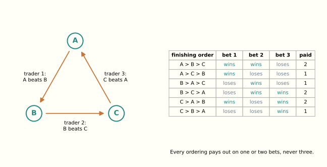
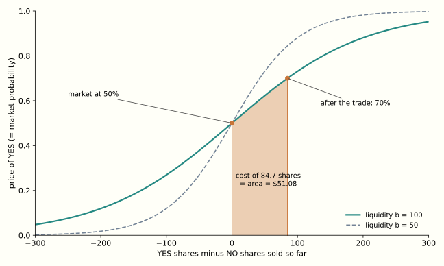

*The mathematics behind this essay, with proofs and the original exercises, is on a [companion page](https://lukstafi.github.io/notes/the-bookmaker-is-a-learner-mathematics.html).*

In the spring of 2010 I was a teaching assistant for the Algorithmic Game Theory course at the University of Wrocław. Each week the course had a one-hour lecture and a one-hour exercise session. The lecturer, Sebastian Bala, gave the lectures, and I ran the exercise sessions. I also gave one lecture, on prediction markets, and wrote two of the exercise sets. The lecture notes open with what a corporate prediction market was for, quoting a vendor's case study of a large telecommunications company. Its employees traded on questions like these:

- How many critical bugs will be in the bug tracking system for Product X by date Y?
- Will the outsourcing supplier of widget X fill its order by the agreed date?
- Will competitor X be able to develop technology capability Y by date Z?

Sixteen years later, prediction markets are a large business, and the questions are different. In September 2026 more than half of the volume on Kalshi, the largest American venue, was in parlays: bets that every one of several results, mostly in sports, goes a stated way. The corporate markets are gone. The company that inherited the vendor's platform stopped running markets in 2022.

The notes were about a piece of mechanism design: how to build an automated bookmaker that always quotes a price, cannot lose more than a fixed subsidy, and pays traders for making its prices more accurate. The notes called it *bukmacher*, the bookmaker. The central fact about such a bookmaker is that it is a learning algorithm. Its prices are a learner's weights over the possible outcomes, and its worst-case subsidy is bounded by the learner's regret. The rest of this essay unpacks that identity and follows it to the point where it meets a computational wall. The notes stop at that wall, with three section headings and no text under them. I finish those sections here, and then ask what the markets of 2026 built instead of the bookmaker, and what a market adds that a scoring rule alone does not.

## Three ways to settle a bet

The notes distinguish three kinds of market. In the first, traders submit orders, and the market executes a trade whenever orders match. Stock exchanges work this way. In the second, every bettor puts money into a pool, and when the outcome is known the pool is divided among the winners. This is the pari-mutuel system of horse racing. In the third, each trader deals directly with a bookmaker who quotes a price, and the payout is fixed at the moment of the trade.

The first kind has a liquidity problem. A trader who wants to bet that a candidate wins at 30 cents needs someone willing to take the other side at that price, now. In a thin market nobody is. The problem gets worse when the bets are combinatorial. Suppose three runners A, B and C are in a race, and three traders bet on pairs: one that A finishes ahead of B, one that B finishes ahead of C, one that C finishes ahead of A. No two of these orders match each other. Yet all three can clear together, because they cannot all win.

If each bet pays \$1 and each trader pays 70 cents, the house collects \$2.10 and pays out at most \$2, whatever the finishing order. Finding such combinations among thousands of orders is a computational problem, and later it will turn out to be a hard one. The third kind of market avoids the matching problem altogether. The bookmaker always takes the other side, and the traders never need to find each other. The price of that convenience is that the bookmaker can lose money, so it needs a pricing rule that bounds the loss.

> **Horses before goods.** The notes include, as an exercise in convex optimization, the Eisenberg–Gale program for the Fisher market. Buyers with budgets $e_i$ and linear utilities $u_{ij}$ for goods $j$ face prices, and the market-clearing prices come from maximizing $\sum_i e_i\log u_i$ subject to supply, where $u_i=\sum_j u_{ij}x_{ij}$ is buyer $i$'s total utility. The logarithm is there because the solution must not change when one buyer's utilities are rescaled, or when one buyer's budget is split between two identical buyers. Maximizing $\sum_i e_i\log u_i$ is maximizing the budget-weighted geometric mean of the utilities, and the geometric mean has both properties. I taught it as a model of market equilibrium. I did not know that Edmund Eisenberg and David Gale [published it in 1959](https://doi.org/10.1214/aoms/1177706369) as "Consensus of subjective probabilities: the pari-mutuel method." The goods were horses, the utilities were the bettors' subjective probabilities that each horse wins, and the clearing prices were the consensus probabilities, which fix the pool's odds. The textbook program for market equilibrium began as a betting pool.

## Paying for honesty

Before a market can price beliefs, it needs a way to pay a single forecaster for an honest forecast. A *scoring rule* does this. A forecaster announces a probability distribution $p$ over $n$ outcomes. When outcome $i$ occurs, they receive $s_i(p)$. The rule is *proper* if a forecaster who believes $r$ maximizes their expected score by announcing $p=r$, and *strictly proper* if any other announcement does worse. The logarithmic rule

$$
s_i(p)=b\log p_i
$$

is strictly proper, and so is the quadratic rule $s_i(p)=b\,(2p_i-\sum_j p_j^2)$, a version of which forecasters know as the Brier score. Any language model trained on next-token prediction is trained on the logarithmic rule: cross-entropy loss is its negative.

Robin Hanson turned a scoring rule into a market by making it a relay. The market holds a current forecast $p$. Any trader may replace it with a new forecast $p'$. When outcome $i$ occurs, that trader is paid $s_i(p')-s_i(p)$: the score of their forecast minus the score of the forecast they replaced. The payment can be negative. Each trader is rewarded only for the improvement they made, measured by the rule. Hanson called this a *market scoring rule*, and with the logarithmic rule it is the *logarithmic market scoring rule*, or LMSR.

The payments telescope. If the forecasts in sequence are $p^0,p^1,\dots,p^T$, the total paid out when outcome $i$ occurs is

$$
\sum_{t=1}^{T}\bigl(s_i(p^t)-s_i(p^{t-1})\bigr)=s_i(p^T)-s_i(p^0).
$$

The bookmaker in effect pays one forecaster, the last, for improving on the first. With the logarithmic rule and a uniform starting forecast, that payment is at most $b\ln 1-b\ln(1/n)=b\ln n$. The bookmaker's subsidy is bounded, however many traders arrive and whatever they do. The parameter $b$ sets both the size of the subsidy and, as we will see, how fast prices move.

> **Worked example.** Two outcomes, YES and NO, with $b=100$. The market stands at 50%. A trader who believes YES has probability 70% moves the forecast to 70%. If YES occurs they receive $100\ln(0.7/0.5)\approx\$33.65$. If NO occurs they pay $100\ln(0.5/0.3)\approx\$51.08$. At their own belief the expected gain is $0.7\cdot 33.65-0.3\cdot 51.08\approx\$8.23$, which is $b$ times the Kullback–Leibler divergence of their belief from the market's previous forecast. If they moved the market to any other number, their expected gain at a belief of 70% would be smaller. The most this market can ever cost its operator is $100\ln 2\approx\$69.31$.

Properness makes honesty optimal one trade at a time. A trader who expects to trade again may do better by bluffing: moving the price the wrong way to mislead those who follow, then trading against them. My notes mention this and stop. [Yiling Chen and colleagues](https://doi.org/10.1007/s00453-009-9323-2) worked out when bluffing pays in equilibrium, and [Michael Ostrovsky](https://doi.org/10.3982/ECTA8479) gave the reassuring general result: for a class of securities he calls separable, information is aggregated in every equilibrium. Bluffing may pay a trader, but for these securities it cannot keep the market from learning what its traders know.

There is also a one-shot version of the idea. [Nicolas Lambert and colleagues](https://doi.org/10.1145/1386790.1386820) characterized the *wagering mechanisms* in which forecasters stake money on their reports and the stakes are redistributed with no subsidy. Each forecaster gets their stake back, plus the stake times the amount by which their score exceeds the stake-weighted average score. Up to technical conditions, it is the only mechanism with five natural properties: it is budget-balanced, anonymous, truthful, sybilproof (splitting an account changes nothing), and normal (when another forecaster gains by changing their report, you do not gain with them). I taught this as the second kind of market.

## One bookmaker, four faces

Hanson's relay is one way to describe the bookmaker. A second way is closer to how a trader experiences it. Yiling Chen and David Pennock described the bookmaker as selling shares. A share in outcome $i$ pays \$1 if $i$ occurs and nothing otherwise. The bookmaker keeps track of $q_i$, the number of shares in outcome $i$ sold so far, and charges according to a *cost function* $C$. Buying a bundle of shares $a$ costs $C(q+a)-C(q)$. The instantaneous price of outcome $i$ is the derivative $p_i=\partial C/\partial q_i$, and a valid cost function keeps these prices nonnegative and summing to one, so they can be read as probabilities. For the LMSR the cost function is

$$
C(q)=b\log\sum_{i=1}^n e^{q_i/b},
\qquad
p_i(q)=\frac{e^{q_i/b}}{\sum_j e^{q_j/b}}.
$$

The prices are a softmax of the shares sold, with $b$ as the temperature. The worked example now reads as a purchase. To move the price of YES from 50% to 70%, the trader buys about 84.73 YES shares for about \$51.08. If YES occurs, the shares pay \$84.73, and the net gain is the \$33.65 of the relay description. The cost of the trade is the area under the price curve between the old share count and the new one.

The two descriptions are one mechanism, and the reason is convex duality. Every valid convex cost function can be written as

$$
C(q)=\sup_{p\in\Delta_n}\bigl(p\cdot q-\alpha(p)\bigr)
$$

for some convex function $\alpha$ on the probability simplex $\Delta_n$. The price vector at $q$ is the maximizing $p$. Readers who know convex analysis will recognize $C$ as the convex conjugate of $\alpha$. The function $\alpha$ is the relay's scoring rule seen from inside: $\alpha(p)$ is the expected score of a forecaster who believes $p$ and announces it, and each of the two determines the other. For the LMSR, $\alpha(p)=b\sum_i p_i\log p_i$, which is $b$ times the negative entropy. The bookmaker's worst-case loss is the range of $\alpha$ over the simplex. For the LMSR that range is $b\ln n$ again, as it must be. ([Chen and Jennifer Wortman Vaughan](https://arxiv.org/abs/1003.0034) proved the general correspondence, and the companion page gives the details.)

A third description came from operations research. Shipra Agrawal, Erick Delage, Mark Peters, Zizhuo Wang and Yinyu Ye proposed a *sequential convex pari-mutuel mechanism*. Each order names a limit price, a maximum quantity, and a set of outcomes. The bookmaker decides how much of the order to fill by solving a small convex program, whose objective is its worst-case profit plus a concave term that damps price swings. The price charged is not set by a formula. It is read off the solution: it is the program's *dual variable* for the constraint that tracks shares outstanding. The notes spend several pages deriving these prices from optimality conditions. The original mechanism had a flaw: it charged the whole order at the final marginal price, which made it worthwhile to buy a portfolio that did not match one's beliefs. [The repaired version](https://doi.org/10.1287/opre.1110.0922) charges the integral of the marginal price over the order. That repair makes the mechanism a cost-function market, with cost function $C(q)=\min_t\bigl(t-u(t\mathbf 1-q)\bigr)$. Here $t$ is the liability the bookmaker provisions for in every outcome, $\mathbf 1$ is the all-ones vector, so $t\mathbf 1-q$ is its slack in each outcome, and $u$ is the concave damping term.

> **Linear programming, and multipliers as prices.** [*How Does a Policy Improve?*](https://lukstafi.github.io/notes/how-does-a-policy-improve.html#improving-a-distribution-without-throwing-away-the-prior) introduced Lagrange multipliers as prices for exceeding a constraint. Linear programs are the case where that reading is exact and the calculus closes on itself. Take
>
> $$
> \max_x\ c\cdot x\quad\text{subject to}\quad Ax\le d,\ x\ge 0.
> $$
>
> Attach a multiplier $y_k\ge 0$ to each constraint. The Lagrangian is $c\cdot x-y\cdot(Ax-d)$, and maximizing it over $x\ge0$ gives a finite upper bound only when $A^\top y\ge c$. The bound is then $y\cdot d$. So the multipliers solve another linear program, the *dual*:
>
> $$
> \min_y\ d\cdot y\quad\text{subject to}\quad A^\top y\ge c,\ y\ge 0.
> $$
>
> Weak duality takes one line: for any feasible pair, $c\cdot x\le (A^\top y)\cdot x=y\cdot (Ax)\le y\cdot d$. Strong duality says the two optima are equal whenever either is finite, with no further condition; for general convex programs the earlier essay needed a strictly feasible point. Complementary slackness carries over: a constraint with slack has a zero multiplier. The price reading is now literal. If $x$ is a production plan, $A$ the resources each unit consumes and $d$ the stocks, then $y_k$ is the rate at which the best profit rises per extra unit of resource $k$. It is the price at which the producer would be indifferent to buying or selling more.
>
> Three instances appear in this essay and its neighbours. A two-player zero-sum game is a pair of dual linear programs, and each player's optimal mixed strategy is the other player's vector of multipliers. That is von Neumann's minimax theorem, and the notes derive it this way. In *How Does a Policy Improve?*, [REPS](https://lukstafi.github.io/notes/how-does-a-policy-improve.html#reps-and-the-consistency-of-state-distributions) attaches a multiplier $V(s)$ to the flow constraint at each state. With the KL term removed, the problem is the linear program over state–action frequencies, and its dual constraints are the Bellman inequalities. As that essay put it, "value-like quantities can arise as prices enforcing consistency between states." The bookmaker's prices are the third instance: they are the multipliers on the constraints that tie the shares outstanding in each outcome to the bookmaker's worst-case liability. The concave damping term makes the program nonlinear, but the prices are still multipliers. Linear programming returns in a later section, with a program that has one constraint for every possible outcome, far too many to write down.

A fourth face appeared after 2010, in a place my notes could not anticipate. Decentralized exchanges such as Uniswap trade tokens through *constant-function market makers*: a pool holds reserves of several assets and accepts any trade that keeps a fixed function of the reserves constant. In 2023 [Rafael Frongillo, Maneesha Papireddygari and Bo Waggoner](https://arxiv.org/abs/2302.00196) showed that every such market maker with a concave potential "is equivalent to a cost-function prediction market," and that it "implicitly defines a proper scoring rule." In this precise sense, Uniswap's pools are bookmakers in disguise. The construction that the prediction-market literature built for eliciting beliefs became the core of decentralized finance under another name.

## The bookmaker is a learner

Here is the identity the essay is named for. Consider the problem of *learning from expert advice*. There are $n$ experts. In each round, each expert $i$ earns a gain $g_{i,t}$, and a learner who has spread its attention as a distribution $w_t$ over the experts earns the weighted average $w_t\cdot g_t$. The learner's *regret* after $T$ rounds is the total gain of the best single expert in hindsight minus the learner's own total. A *no-regret* algorithm keeps the regret growing slower than $T$. The standard one, Hedge (also called exponential weights or weighted majority), sets

$$
w_{i,t}=\frac{e^{\eta G_{i,t-1}}}{\sum_j e^{\eta G_{j,t-1}}},
\qquad G_{i,t}=\sum_{\tau\le t} g_{i,\tau},
$$

and its regret is at most $\ln n/\eta$ plus a term that grows with $\eta$ and with the size of the gains.

Now make the outcomes of a market the experts, and let the shares a trader buys in outcome $i$ at step $t$ be expert $i$'s gain at that step. The accumulated gains are the share counts, $G_{i,t}=q_{i,t}$. Hedge with learning rate $\eta=1/b$ assigns weights $e^{q_i/b}/\sum_j e^{q_j/b}$, which are exactly the LMSR prices. The bookmaker's books then read as the learner's ledger. Because $C$ is convex, every trade costs the trader at least what its shares would cost at the prices quoted before it, which is $w_t\cdot g_t$. So the bookmaker's revenue is at least the learner's total gain $\sum_t w_t\cdot g_t$. When outcome $i$ occurs, the bookmaker pays out $q_i$, which is at most the best expert's total gain. The bookmaker's loss is therefore at most the learner's regret. Hedge's bound is $b\ln n$ plus a term that vanishes as trades become small, the same subsidy the telescoping relay gave directly. [Chen, Fortnow, Lambert, Pennock and Wortman](https://arxiv.org/abs/0802.1362) noticed this in 2008. My notes reproduced their argument.

The identity also runs the other way. A learner can feed each round's gains to a bookmaker as a trade and use the resulting prices as its weights. Chen and Wortman Vaughan showed in 2010 that any cost-function bookmaker with bounded loss $B$ and smoothly varying prices yields a no-regret learner, with regret at most $\sqrt{2B\varphi T}$, where $\varphi$ bounds how fast prices respond to trades. For the LMSR, $B=b\ln n$ and $\varphi=2/b$, so the regret is at most $2\sqrt{T\ln n}$. The liquidity parameter cancels, as it should: a learner's regret cannot depend on the currency in which the market is denominated. The function $\alpha$ of the dual description is the regularizer of the learning algorithm called *follow the regularized leader*. That algorithm picks the weights $w_t=\arg\max_{w\in\Delta_n}\bigl(w\cdot G_{t-1}-\alpha(w)\bigr)$, which is the dual formula for the bookmaker's prices, with gains in place of share counts. The negative entropy that defines the LMSR is the regularizer that yields Hedge.

What does the identity say about markets? The liquidity parameter $b$ is an inverse learning rate. A deep market, with large $b$, moves slowly in response to each trade and risks a larger subsidy. A shallow one moves quickly and risks little. The bookmaker pays for information at most what a learner pays in regret for not knowing in advance which expert is best. Its worst case comes when the best expert is the outcome that occurs.

The same exponential reweighting has appeared on this blog twice before. In *How Does a Policy Improve?* the regularized improvement step reweights a reference policy by $e^{Q/\eta}$, and its optimal value is $\eta\log Z$. That is the LMSR cost function in another notation, with the reference policy as the starting prices and $\eta$ as the liquidity. In [*Who Teaches the Weights?*](https://lukstafi.github.io/notes/who-teaches-the-weights.html#what-on-policy-training-forgets), repeated improvement steps compound: "after $k$ such steps the policy is the original one tilted by $kR/\eta$." That is Hedge's accumulation of gains, applied to a policy rather than to prices.

After 2010 the identity was generalized and absorbed. [Jacob Abernethy, Chen and Wortman Vaughan](https://doi.org/10.1145/2465769.2465777) derived the duality-based cost function, for any space of securities, from three axioms: path independence, no arbitrage and responsiveness to trades. They showed that trading in such a market is follow the regularized leader. Later work read the price dynamics as stochastic mirror descent. What my notes presented as a surprising pair of theorems is now the standard way to design a market maker in the literature.

## The combinatorial wall

A market on one race with $n$ runners has $n$ outcomes. A market on the finishing order has $n!$, and the interesting bets are about the order. The notes follow [Chen, Lance Fortnow, Evdokia Nikolova and Pennock](https://doi.org/10.1145/1250910.1250957) in using two languages for such bets. In *subset betting*, a trader bets that runner $i$ finishes in one of a set of positions, or that one of a set of runners finishes in position $j$. In *pair betting*, a trader bets that one runner finishes ahead of another, as A ahead of B in the first section.

Consider first the matching problem of the first kind of market. Which orders can the house accept together without risking a loss in any of the $n!$ outcomes? Written as a linear program, it has one constraint for every outcome. For subset betting with divisible orders it is nevertheless solvable in polynomial time. The ellipsoid method never needs the whole list of constraints. It needs only a way to find a violated one. Here that means finding the finishing order in which the accepted bets would cost the house most, and that is a maximum-weight matching between runners and positions. Pair betting looks simpler, with only $n(n-1)$ possible bets. Yet matching is NP-hard for pair betting, whether orders are divisible or not. The reason is the three-bet cycle of the first section, grown large. A set of pair bets is a directed graph on the runners. The worst finishing order for the house is the one that agrees with as many accepted bets as possible. Finding it means removing the fewest edges that leave the graph acyclic, which is the minimum feedback arc set problem, and that problem is NP-hard. Single profitable cycles can be found in polynomial time. Give each bet the weight one minus its price. A cycle is profitable for the house when its total weight is below one, as in the race of the first section, where it is $3\times0.3=0.9$, so a shortest-cycle search finds the profitable ones. But cycles that overlap can be profitable together when none is profitable alone, and the greedy method of taking the shortest cycle first misses them.

The bookmaker's pricing problem is worse. For subset betting, every bet can be built from shares in single runner–position pairs. Let $q_{kl}$ be the shares sold in "runner $k$ finishes in position $l$," and let a finishing order $\sigma$ put runner $k$ in position $\sigma(k)$. The LMSR price that runner $i$ finishes in position $j$ is then a ratio of two sums over all $n!$ finishing orders:

$$
p_{ij}=\frac{\sum_{\sigma:\,\sigma(i)=j}\ \prod_{k}e^{q_{k\sigma(k)}/b}}{\sum_{\sigma}\ \prod_{k}e^{q_{k\sigma(k)}/b}}.
$$

The denominator is the permanent of the matrix with entries $e^{q_{kl}/b}$: the determinant's sum over permutations, without the signs. Computing permanents is #P-hard: at least as hard as counting the solutions of any problem in NP. For pair betting, the corresponding sum counts orderings consistent with a partial order, which is also #P-hard. So an exact LMSR bookmaker for either language is intractable. My notes prove these results and then list three section headings with nothing under them: learning that minimizes regret against the best permutation; polynomial-time approximation of subset-betting prices; polynomial pricing for tournaments. The paper they come from, by Chen, Fortnow, Lambert, Pennock and Wortman, answers the first two with a single construction, and a companion paper answers the third.

The first answer uses the identity of the previous section. If the LMSR is Hedge, then any tractable learner can be turned into a tractable bookmaker. David Helmbold and Manfred Warmuth had designed [a Hedge-like learner over permutations](https://jmlr.org/papers/v10/helmbold09a.html). Instead of weights on all $n!$ orderings, it keeps an $n\times n$ matrix of weights, one for each runner and position. After each round it multiplies each entry by an exponential factor and then rescales rows and columns alternately until every row and column sums to one, a procedure called Sinkhorn balancing. Run as a bookmaker, it quotes subset-betting prices in polynomial time, and its regret bound becomes a bound on its loss: $b\,n\ln n$ when trades are split finely, close to the $b\ln n!\approx b\,(n\ln n-n)$ of the exact LMSR. This bookmaker is not the exact LMSR. It is a different bookmaker, whose price matrix plays the role of the runner-by-position marginals. The identity is what licenses the substitution: what we need from a bookmaker is a bounded loss and prices that move toward the traders' information, and a learner with bounded regret supplies both.

The second answer changes the language instead of the bookmaker. [Chen, Sharad Goel and Pennock](https://doi.org/10.1145/1374376.1374421) studied single-elimination tournaments, such as a knockout bracket of 64 teams. Pricing arbitrary bets on such a tournament is still #P-hard. But for natural bets such as "team $i$ wins game $k$" and "team $i$ beats team $j$ if they meet," the LMSR distribution over outcomes stays representable as a Bayesian network shaped like the bracket. A trade on such a bet multiplies the probability of every outcome in the event by the same factor, and for these events the factor touches only a few local tables of the network. Prices stay exact, and each trade takes $O(n^3)$ operations for $n$ teams.

After 2010, the wall was approached as an optimization problem. The set of price vectors that are consistent with some probability distribution over outcomes is a polytope, the *marginal polytope* familiar from graphical models. A combinatorial bookmaker that cannot compute exact prices can instead keep its prices inside that polytope by projecting onto it. [Christian Kroer, Miroslav Dudík, Sébastien Lahaie and Sivaraman Balakrishnan](https://doi.org/10.1145/2940716.2940767) did this with the Frank–Wolfe algorithm, which needs only a linear optimization oracle over the polytope, and supplied that oracle by integer programming. Their bookmaker ran on the 2010 NCAA tournament, an outcome space of $2^{63}$ elements, although within its 30-minute limit the full projection first completed only after 45 of the 63 games had been played. Variational inference in graphical models works over the same polytope. The oracle repeats the move of the ellipsoid method's separation step: never list the outcomes, only find the extreme one.

## What 2026 built instead

The prediction markets that grew large in the 2020s did not adopt the bookmaker. Kalshi and Polymarket, the two largest, run limit order books, the first kind of market. Professional firms quote on both sides, and the venues pay them. Kalshi signed its first institutional market maker, Susquehanna, in 2024. Polymarket began on an automated market maker, a fixed-product design rather than the LMSR, and moved to an order book during 2022. By the Uniswap result of the four-faces section, that design was a cost-function bookmaker too. I found no notable real-money venue running one in 2026. The subsidy survives as liquidity rewards paid to the firms that quote, a cash budget rather than a bound like $b\ln n$. The play-money venue Manifold uses automated market makers, and the mechanism-design literature continues to propose new ones.

The largest product of 2026 is combinatorial, in the simplest bidding language there is. A parlay is a conjunction of legs: this team wins, and that game goes over a total, and a third player scores. On Kalshi such "combos" made up [58% of volume in September 2026 but under 13% of transactions](https://www.cnbc.com/2026/10/06/prediction-market-combo-contract-volume.html). Polymarket's American exchange launched combos in August and by October they were about half of its weekly volume. Neither venue lists combos on its order book, and neither runs a bookmaker that holds a joint distribution over the legs. Kalshi's help pages say it plainly: ["Combo prices are determined through a Request For Quote (RFQ) system."](https://help.kalshi.com/markets/combos) A trader requests a quote, and dealers answer. In May 2026 the analytics firm Oddpool [sampled Kalshi's quote requests](https://www.oddpool.com/research/kalshi-rfq-market-makers) and found 13 distinct dealers, two of which answered about half of all requests. Requests outside sports got "zero quotes, from zero makers." From response times, the authors inferred that only one dealer priced the correlations between legs, and "our reading is that it's the only maker in the visible universe actually running correlation-aware combo pricing." The others, they suspect, price legs as if they were independent.

That is the combinatorial wall, sidestepped rather than climbed. Almost nobody in the system keeps a joint distribution. The venue keeps none, one dealer seems to model the correlations, and the others, by Oddpool's guess, multiply single-game prices together.

Consistency between related markets is left to traders. When separate markets ask logically linked questions, their prices can contradict each other, and the contradictions are profits for whoever notices. [Oriol Saguillo and colleagues](https://arxiv.org/abs/2508.03474) estimated about \$40 million of realized arbitrage profit on Polymarket, in markets that resolved between April 2024 and April 2025. Some came from single markets whose outcome prices did not sum to one, and some came from combinations of linked markets. Polymarket does enforce one kind of consistency in its contracts. For a question with mutually exclusive answers, a NO share on one answer can be converted into YES shares on all the others, which ties the prices of the answers together without a bookmaker. That is the rule that the prices of exclusive answers sum to one, built into the tokens. Everything more structured is left to arbitrageurs, and where they act, they draw the market's boundary.

The corporate markets my notes opened with are gone, and the reasons their best-known vendor gave are instructive. In 2022 Cultivate Labs, the successor to the Inkling platform whose case studies the notes quote, [stopped supporting prediction markets](https://www.cultivatelabs.com/posts/why-we-stopped-supporting-prediction-markets). It cited four problems. A price depends on the whole sequence of trades, so a crowd forecast cannot be recomputed from a chosen subset of forecasters, such as the best ones. The market currency intimidates people. Markets invite manipulation, through duplicate accounts or questions written by people who control the outcome. And "we don't know what game people are playing." Cultivate kept its forecasters and replaced the market with opinion pools rewarded by a proper scoring rule. In the terms of the second section, it kept the score and removed the relay. The vendor conceded that market prices had been about as accurate as the alternatives.

Several things my notes did not model now matter more than mechanism design. Sports account for most of the volume. A [study of Kalshi prices](https://www2.gwu.edu/~forcpgm/2026-001.pdf) by Constantin Bürgi, Wei Deng and Karl Whelan finds that prices become more accurate as events approach, and that they carry the old favourite–longshot bias: cheap contracts on unlikely outcomes are overpriced. Traders who took prices lost much more on average than traders who quoted them. Wash trading, insider trading, disputes over how questions resolve, and lawsuits between the venues and American states have filled 2026. None of this bears on the mathematics, and all of it bears on whether a market's price is the aggregate of its traders' information.

## What a market adds to a scoring rule

The relay is what makes a market more than a scoring rule. A scoring rule pays each forecaster for their forecast. A market scoring rule pays each trader only for the part of their forecast that the market did not already have. That is Hayek's "economy of knowledge" in the form of a payment rule: the price carries what is known, and a trader is paid for adding to it.

Machine forecasters have been measured against human ones since 2024, and by 2026 the gap has nearly closed. In Metaculus's benchmark series, its professional forecasters beat the best bots by wide margins through 2025, and in the spring 2026 round the gap was no longer statistically significant. The ForecastBench benchmark reported in July 2026 that the best models had likely reached parity with superforecasters. The [Prophet Arena](https://arxiv.org/abs/2510.17638) benchmark shows what a market rewards. On 1,367 Kalshi events, GPT-5's forecasts were better calibrated than the market's prices. Betting on them still returned 94 cents per dollar staked. Betting blindly at the market's own prices returned 90 cents, so the better forecasts narrowed the loss without turning it into a profit. A market pays a trader only for moving its price toward the truth, and only when the move is worth more than the cost of trading. A forecaster whose information is mostly in the price already has little to sell.

Markets made of language-model traders show the same thing from the other side. A 2026 study by [Begin and colleagues](https://arxiv.org/abs/2606.26583), "Preference Optimization Drives Monoculture in LLM Prediction Markets," ran simulated markets on binary questions from a truthfulness benchmark, mostly with one small open model. The errors of the preference-tuned traders were correlated at about 0.7, and a market of ten of them was right 67.6% of the time, against 70.2% for a single agent. A market aggregates diversity of information, not the number of traders. In LMSR markets studied by [Galanis](https://arxiv.org/abs/2604.20050), language-model traders hit a second limit: they failed to aggregate information "where more than two levels of interactive reasoning are required." [*What Persists When Agents Change?*](https://lukstafi.github.io/notes/what-persists-when-agents-change.html#shared-weights-divergent-trajectories) made the matching caution for teams of agents: "neither the frequency of disagreement nor the number of models tells us whether their errors are independent." *Who Teaches the Weights?* found the learning-side twin: "Diversity along axes that do not disagree has nothing to offer."

The 2026 markets kept a relay for sports, in the looser form an order book gives it, and dropped it for organizations. AI forecasting kept the score and has yet to supply the diversity the relay needs.

## Is the market minded?

[*Is the Monastery Minded?*](https://lukstafi.github.io/notes/is-the-monastery-minded.html#the-nation-and-residual-integration) left one case open. It argued that the United States has no mind of its own, because the integration the nation adds beyond its institutions is thin. Its channels "carry reports and scalar signals." The price system escaped the argument. "A price is corrected when traders assess its earlier value, which makes it a regulated carrier in our sense, and prices across a market constrain one another." Its boundary "is drawn by arbitrage." Orders are signals "in the system's own currency." That essay left open whether psychology gains any traction on such a system. A prediction market is the cleanest case to test, because its prices are explicitly probabilities, and the bookmaker is a learner by construction.

Take four of the five conditions in turn, leaving aside content at several levels. *Accuracy-responsiveness* the bookmaker has by design: its prices are revised by trades that the scoring rule rewards only when they move the price toward the truth, and the revision rule is a no-regret learning algorithm. *Unity* depends on the market's design. An LMSR over all the outcomes of a question is a single economy: a purchase in one outcome moves every other price, through the bookmaker's own state. A set of separate binary markets is closer to the monastery that only counts votes. Arbitrage still draws one boundary around such markets, as the monastery essay said. But their prices are coupled only when some arbitrageur notices a contradiction, and the coupling runs through that trader's head rather than through the market's own state. *Vehicles*: an exact combinatorial bookmaker holds a distribution over all $n!$ finishing orders, which is as counterfactually rich as a vehicle can be, and it is the vehicle that cannot be computed.

*Simulation* is where the cases divide, as it was for the monastery. In a market of independent contracts, every model of the world runs inside some trader. The market receives only the outputs, as orders. That is simulation by delegation, which the monastery essay found fails the condition because the run is private: only its output enters the system, and the system's own processes play no part in the transformations. The verdict qualifies the monastery essay, which credited futures prices with running a model of the world forward: a futures price is corrected as its date approaches, but each correction is computed in some trader's head. The tournament bookmaker is different. When a trade moves the price that team $i$ wins its first game, the bookmaker's Bayesian network propagates the change through the bracket, to the price that $i$ reaches the final and that its later opponents do. That propagation is the bookmaker's own transformation, and it mirrors the structure of the tournament. It is the simulation by artifact that the monastery essay found in the computus, the tables by which a monastery reckoned the date of Easter. The tournament bookmaker runs a model of its domain forward. The 2026 venues do not: their parlays are priced by dealers who mostly assume independence, and the joint structure lives, when it lives anywhere, in the one dealer who models correlations. In the monastery essay's terms, that is still delegation: a member runs the model privately, on the market's prices, and only its quote enters the market.

So the market whose claim to a thin mind is strongest is the one my notes described and the 2026 venues did not build. Even there the claim is weak. An LMSR bookmaker has one economy, accuracy-responsive dynamics, and in its tournament version a simulation it runs itself. But its accuracy-responsiveness is the learning of a single distribution about a single question, which ends when the question resolves. [*Which AGI?*](https://lukstafi.github.io/notes/which-agi.html#three-grains-three-thresholds) called the intelligence of the economy, in Hayek's sense, "real efficacy without an entity," lacking "diachronic unity." A prediction market resolves and closes, and nothing it learned carries into the next market, except in the wealth of the traders who were right. That wealth is a kind of memory. Cultivate Labs' first complaint was that a market's price cannot be recomputed from its best forecasters alone. Over time, a market does weight them. It does so across many questions, through their accumulated money. For traders who stake a fixed fraction of their wealth, the reweighting is multiplicative, as in Hedge: a second learner at a longer timescale, with traders as its experts. Whether psychology has anything to add to that description, beyond economics, I leave where the monastery essay left it.

## Closing the notes

My 2010 notes were a snapshot of a field in a productive year. The identity between bookmakers and learners had just been proved in both directions. The equivalence of the relay, the cost function and the SCPM was new, and the combinatorial results were two and three years old. The notes' empty sections were filled within the same papers they drew on, and I could have filled them then. What I could not have seen was where each part would go. The cost function went to decentralized exchanges. The scoring rule went to the organizations that gave up on markets, and to the benchmarks that rank machine forecasters. The learner view went into the research that keeps combinatorial bookmakers tractable. The real-money markets took none of these. They took the order book, the dealer and the parlay, and left the joint distribution to one dealer, or to nobody.

---

*Sources.* The 2010 lecture notes are summarized and corrected on the [companion page](https://lukstafi.github.io/notes/the-bookmaker-is-a-learner-mathematics.html), which gives full references for the theory. Robin Hanson, "Logarithmic market scoring rules for modular combinatorial information aggregation," *Journal of Prediction Markets* 1(1), 2007. Yiling Chen and David Pennock, "A utility framework for bounded-loss market makers," UAI 2007. Agrawal, Delage, Peters, Wang and Ye, "A unified framework for dynamic prediction market design," *Operations Research* 59(3), 2011. Chen, Fortnow, Lambert, Pennock and Wortman, "Complexity of combinatorial market makers," EC 2008. Chen and Wortman Vaughan, "A new understanding of prediction markets via no-regret learning," EC 2010. Abernethy, Chen and Wortman Vaughan, "Efficient market making via convex optimization, and a connection to online learning," *ACM TEAC* 1(2), 2013. Frongillo, Papireddygari and Waggoner, "An axiomatic characterization of CFMMs and equivalence to prediction markets," ITCS 2024.

*This article was co-authored by Łukasz Stafiniak and Claude (Opus 5.5).*
