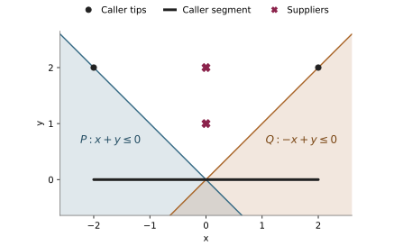
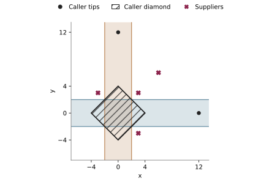

Three callers expose three different losses in inference. Two bounds on the same hidden number can justify a weaker function precondition than the first successful answer. Two package keys can jointly protect a caller even when neither key covers its entire branch. An ordinary list argument can carry a length fact that inference currently rediscovers only by a pattern match. The first example changes the native compiler. The other two have executable constructions.

## Improving a successful arithmetic answer {#guards}

A constructor hides a number $x$ and publishes indices $i,j$ with $x\le i$ and $x\le j$. The function `check` compares the payload with a public cap $z$. Its weakest safe guard is $\min(i,j)\le z$. Choosing $x=\min(i,j)$ proves necessity. InvarGenT previously found $j\le z$ and stopped. It now infers the minimum and runs both calls at $(i,j,z)=(0,6,0)$ and $(8,2,2)$. A call with payload 3 and cap 2 is rejected. [Program](broader_guard.gadt) · [Prior search](thesis-review-54.html#alternatives)

The ordinary search records when a goal involving a private variable produces two distinct candidate inequalities. For an eligible successful definition, it replays inference. In the replay each candidate must independently prove the goal under the branch premises before the abducer can try their disjunction. All branch obligations still run. For instance, change the function to check a second payload with public index $j$ against the same cap. The call with payloads $(0,4)$ and cap 0 must now fail. It does. [Native replay and controls](thesis-review-55-views.py)

The final comparison aligns the two schemes' public input variables by their positions in identical first-order argument constructors. Every quantified variable must be determined there. The result type must agree under that alignment, including any dependency on an input. In rational arithmetic the old guard must imply the new guard and the converse must fail. This pass applies to unannotated nonrecursive functions with a previously inferred guard and no fresh result package. More than two alternatives, incomparable schemes, and improvements that change the result relationship are still open.

## A caller cell that two keys must split {#split}

Give each input a neutral key. It can admit two extra keys on supports $P$ and $Q$, each a conjunction of weak affine inequalities. A result opens at an input if every admitted key stores it. Suppose a nonempty region $B$ supplies one marked result and every caller in $H$ must exclude it. The neutral key stores the marker. Every extra key used to exclude it must miss $B$. A solution therefore exists exactly when $H\subseteq P\cup Q$ and both supports miss $B$. An unused extra key can be given empty support. Conversely, store the marker at the neutral key alone and permit every other result at every key. This constructs the package as well as its admissions. [Opening semantics](thesis-review-48.html#symbolic)

The three caller cells are the tips $(-2,2),(2,2)$ and the entire base segment $[-2,2]\times\{0\}$. Place the suppliers at $(0,1)$ and $(0,2)$. The halfspaces $P=\{x+y\le0\}$ and $Q=\{-x+y\le0\}$ work. The left tip belongs to $P$ and the right tip to $Q$. The base switches keys at zero. Any convex support containing both tips contains the supplier at their midpoint. Any support containing one tip and the entire base contains $(0,1)$, halfway to the opposite endpoint. Assigning a single key to each whole caller cell would reject this instance. [Lean proof](thesis-review-55.lean)



Even a single straight cut through each caller cell can be too restrictive. Take the diamond $|x|+|y|\le4$ and two more callers at $(12,0)$ and $(0,12)$. Put suppliers at $(6,6),(3,3),(-3,3),(3,-3)$. The strips $|x|\le2$ and $|y|\le2$ cover every caller and avoid every supplier. In *any* two-key solution the two outer tips need different keys because their midpoint is $(6,6)$. Each horizontal vertex of the diamond needs the horizontal tip's key. One quarter of the way from that vertex to the vertical tip is the supplier $(3,3)$ or $(-3,3)$. The same argument forces the diamond's two vertical vertices onto the other key. A line separating the two keys' portions of the diamond would therefore weakly separate the horizontal vertex pair from the vertical pair. For a cut $ax+by=c$ this forces $4|a|\le c\le-4|b|$, hence $a=b=0$. The two-key search must allow a more general division even inside this single bounded cell. [Strip certificate](thesis-review-55.py) · [Lean proofs `forced_axes` and `cannot_cut_diamond`](thesis-review-55.lean)



## Constructing both supports {#keys}

Let $H=\bigcup_i H_i$ and $B=\bigcup_{j=1}^m B_j$ be finite unions of nonempty closed rational polyhedra. A cell can be given by weak inequalities, as it is in a clause, or by finitely many generating points and recession rays. A line can use both opposite rays. Work first over the reals. With empty $B$ the whole space is available. Otherwise **two supports, if feasible, need at most $2m$ inequalities in total**.

For each key $a$ and supplier cell $B_j$, seek an affine form $f_{aj}$ that is at most zero throughout $B_j$. Define key $a$ by the inequalities $f_{aj}\ge1$ for every $j$. To see that these suffice, start with any successful supports. Farkas' lemma separates each nonempty support from each disjoint supplier polyhedron with a positive gap, which can be scaled to one. An empty support may use zero forms. Intersecting the new halfspaces for a key preserves all its old callers and still excludes every supplier. [Polyhedral separation certificate](https://people.math.carleton.ca/~kcheung/math/notes/MATH3801/04/4_1_farkas_lemma.html)

For a caller $x$, membership in either complete support is equivalent to $f_{1j}(x)\ge1$ or $f_{2k}(x)\ge1$ for **every** pair $(j,k)$. If membership fails for both keys, one failed inequality from each supplies a counterexample pair. Fix one pair and one caller cell $H_i$. The pair condition holds on the whole cell iff there is a single $t\in[0,1]$ such that
$$
 t f_{1j}(x)+(1-t)f_{2k}(x)\ \ge\ 1\qquad(x\in H_i).
$$
Indeed, the affine image of $H_i$ under the two forms is convex. The pair condition says that this image misses the open quadrant $(-\infty,1)^2$. A separating normal has nonnegative coordinates because the quadrant extends downward in both directions. Normalize their sum to one. The supremum on the quadrant is then one, yielding the displayed inequality. Conversely, if both forms were below one, their mixture would be too. The weight may differ between pairs and cells. [Separation theorem in §2.5.1](https://web.stanford.edu/~boyd/cvxbook/bv_cvxbook.pdf) · [Lean checks for distribution and mixture](thesis-review-55.lean)

Check the mixture on each generating point and its linear part on each ray. Check the supplier inequalities the same way with signs reversed. For a cell given directly by $Mx\le d$, impose any required upper bound $a\cdot x+b\le0$ by introducing $u\ge0$ with $u^TM=a^T$ and $u^Td\le-b$. This is exact by Farkas' lemma for a nonempty cell. The caller's mixture is handled by giving $1$ minus the mixture as the row to bound by zero. Thus either input representation gives a polynomial-size existential real system for two keys, without converting between representations. The products of weights and face coefficients make it bilinear. Real feasibility is decidable. The size estimate concerns the formula, without a running-time or coefficient-bit bound.

**When all caller cells are bounded, real feasibility is equivalent to existence of rational supports.** Double every face of a real solution. At a covered point all faces of at least one key now reach two. The coefficient vectors valid at level zero on a given supplier form a rational polyhedral cone, so rational vectors are dense in it. Approximate each doubled face inside its own cone. The union of caller cells is compact, so sufficiently close approximations change every value there by less than one. Each caller retains a key and each supplier remains excluded. Given an algebraic model one can shrink rational boxes around its doubled faces, solve rational linear systems inside the cones and check the resulting supports against the original coverage and exclusion obligations. This terminates under the bounded-caller hypothesis, including for unbounded suppliers. For rational faces, counterexamples to these obligations are linear systems over rational data, so checking them over the reals also checks rational inputs. [Solver and independent linear certificate check](thesis-review-55.py) · [Z3's real arithmetic procedures](https://theory.stanford.edu/~nikolaj/programmingz3.html)

The same proof works for $k$ extra keys. Distribute coverage over all $m^k$ ways to choose one face from each key. For each choice and each caller cell, separate its image in $\mathbb R^k$ from $(-\infty,1)^k$. The normalized separating normal is now a vector of $k$ nonnegative weights summing to one. This uses at most $km$ faces. The compactness argument for rational reconstruction is unchanged. The replay includes three disjoint caller intervals separated by two suppliers. It rejects two keys and constructs three. [Fixed-budget synthesis](thesis-review-55.py)

For unbounded caller cells the real criterion still applies, and each proposed rational answer can still be checked. Uniform rational reconstruction in higher dimensions remains open here. On the line, first reject any intersection of $H$ and $B$. Each remaining connected gap of the complement of $B$ that meets $H$ needs its own interval key. The interval hull of the caller pieces in that gap suffices because it joins finitely many closed intervals with rational finite endpoints. The replay checks 360 one- and two-key decisions against the gap count, as well as examples with rays. The construction treats an explicitly given marker supplier. Inferring such regions from recursive suppliers and feeding the resulting certificate into InvarGenT's induction jump remain separate problems.

## What a bound list value reveals {#values}

Apply the candidate-elimination method of Flanagan and Leino’s Houdini to datatype constructors. Start with a finite pool of proposed index facts for each datatype. At each constructor, assume its guard and the current facts for its immediate inductive fields. Remove every candidate that those premises fail to imply for the result. A failed candidate cannot belong to any jointly inductive subset of the current pool. Its counterexample still satisfies the weaker child assumptions of that subset. Consequently every inductive subset survives every pass. After at most one deletion per original candidate the surviving set is itself inductive and contains all the others. Induction on finite constructor values proves the surviving facts, including for mutually recursive declarations. A foreign producer must supply values satisfying the same contract. [Flanagan and Leino, §3](https://fastpl.doc.ic.ac.uk/SoftwareReliability/2016-2017/papers/Houdini.pdf) · [Pruning and structural induction in Lean](thesis-review-55.lean) · [Executable template elimination](thesis-review-55-views.py)

For a list with indices $0$ and $n+1$, this procedure retains $n\ge0$. Adding a `Debt` constructor at $-1$ eliminates it. For mutually recursive even- and odd-length datatypes the same calculation retains the respective lower bounds zero and one. The list elaboration emits an identity function with the following existential result.

```text
view : ∀a,n. List(a,n) → ∃k[k=n ∧ 0≤k]. List(a,k)
```

Opening `view l` at the second argument of the short `append` exposes the fact about that particular value. InvarGenT then infers $\mathrm{List}(a,k)\to\mathrm{List}(a,n)\to\mathrm{List}(a,n+k)$ with no input guard. The calls on two empty lists and on two singleton lists both run. If the cons constructor already requires a nonnegative tail index, the generated view inspects only the outer constructor. Remove that guard and a shallow view acquires an input precondition. The generator instead opens the tail's view in the cons branch. The induction hypothesis recovers the same unrestricted interface. Both helpers return the original list. The recursive helper can traverse its spine each time a binding opens it. With the constructor guard removed, plain `append` already accepts all lengths. In that variant recursion is needed to export the nonnegativity fact itself. The prototype targets a designated list binding. General placement and erasure of such evidence in the compiler remain open. [Checked program](constructor_value_view.gadt) · [Generator and native comparisons](thesis-review-55-views.py) · [Thesis §5.2.2 example](thesis-review-1.html#what-a-variable-pattern-knows-about-list-length)

## Generating the datatype a caller needs {#programme}

The list view expresses a fact about an existing datatype. A unique-mark tree search goes a step further. The caller needs a path to a mark and evidence that every sibling along that path is empty. Five constructors generated from a supplied finite classification of the search results express these facts. Lean proves that the resulting family is inhabited exactly on trees where the search returns a path. InvarGenT can then infer an existential that pairs a tree and its evidence at a common hidden index. Deriving the classification from the program, and determining when a comparison between siblings needs richer evidence, belong to the separate refined-datatype programme. [Construction, proofs and research programme](refined-datatypes/index.html)

## Replaying the checks {#replay}

The Python drivers require `z3-solver`. From this directory, run the following commands with OCaml on the path. The second driver compiles the inferred clients, runs their OCaml output, and checks the rejection controls.

```sh
python3 thesis-review-55.py
python3 thesis-review-55-views.py --compiler /path/to/InvarGenT.native
```

Lean 4.19 with mathlib checks the propositional distribution, the sufficient mixture inequality, both geometric obstructions and the constructor-induction arguments. The separation and rational-reconstruction proofs are given above. The research replays use temporary compatibility builds of InvarGenT revision `5bea865` for OCaml 5.3.0 and 5.5.1. The full 5.3.0 suite passed all 390 active tests, with ten existing TODOs. All 200 previously generated example signatures match the preceding revision byte for byte. [Lean companion](thesis-review-55.lean) · [Branching example replay](refined-datatypes/replay.py)
