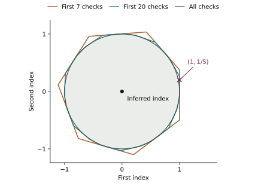

The short indexed-list `append` from thesis §5.2.2 now accepts two empty lists. Its generated OCaml still matches only the first list. Establishing which length facts could be made available at the second list binding exposed a distinction that matters for the compiler. InvarGenT accepts the following closed program.

```text
datatype Tower : num
datacons Floor : Tower 0
datacons Step : ∀n. Tower n ⟶ Tower (n+1)
let rec spiral = Step spiral
let observed : Tower (-1) = spiral
```

Inference gives `spiral : ∀n. Tower n`. At index $q$ its child has index $q-1$, another instance of the same binding. OCaml allocates one constructor whose child pointer leads back to it. The replay checks physical identity at runtime. Every *finite* tower has nonnegative height. Attaching that fact to an arbitrary tower binding would allow a consumer at $-1$ to assume its argument is nonnegative. The proof by structural induction applies when we know the value is finite. OCaml admits cyclic constructor values in its recursive definitions. [Runnable example](constructor_value_bounds.gadt) · [Finite-tower proof](thesis-review-56.lean) · [OCaml manual, recursive definitions of values](https://caml.inria.fr/pub/distrib/ocaml-5.0/ocaml-5.0-refman.html) · [Reynaud, Scherer and Yallop on recursive initialization](https://arxiv.org/abs/1811.08134)

## Facts that are safe to erase {#values}

Take a finite pool of candidate index predicates for each declared datatype. Start with no certified facts. At each round, ask whether every constructor establishes a candidate on its result, given its guard and the facts certified in earlier rounds about its direct value fields. Keep each established fact. A proof from round $k$ needs at most $k$ layers of constructor observations. Induct on $k$. Opening one actual constructor verifies its guard and gives actual child values, even if some of them point back to the same node. The induction hypothesis applies at the smaller observation depth. The compiler can erase this proof without inserting a runtime traversal.

The process terminates after at most as many strict rounds as there are candidates. Its result is the least closed set of certificates in this template system. Any closed set contains the first round and, inductively, every subsequent round. Conversely the fixed point is closed. Starting with *all* candidates and deleting failures, as in review 55, computes the greatest jointly inductive subset. Both procedures justify list nonnegativity when the cons constructor requires a nonnegative tail index. Only the latter justifies it from the two unguarded tower constructors. The cycle above shows why choosing between these procedures changes a type check. Even for acyclic inputs the finite observation procedure can miss true facts. Foreign values must honor their declared indexed constructor contracts. [Lean proofs `stage_sound` and `stage_least`](thesis-review-56.lean) · [Finite-value construction](thesis-review-55.html#values)

InvarGenT checks signs of numeric parameters and orders between pairs of parameters. It uses the constructor declarations of the whole compilation unit, including constructors that occur later. It can propagate facts through wrappers. For example, if a packet constructor guarantees $n\ge0$, a cargo constructor with a field of type $\mathrm{Packet}(n)$ can establish $n\ge0$ one round later. Adding `Owed : Cargo(-1)` prevents that conclusion. Swapping the indices in a wrapper also swaps the order the caller may assume. Abstract datatypes without declared constructors supply no facts.

The compiler rechecks eligible function declarations using the facts at bare argument bindings whose datatype heads it has identified. The pattern constraint requires that head. The constructor facts enter the branch premise at the corresponding indices. On a successful declaration a public guard comparison checks that the new scheme admits the old inputs, admits more index assignments, and preserves the public result type. This also recovers a written first-order signature that inference had unnecessarily strengthened. For the short `append`, `LNil` supplies the fact at zero and the guard of `LCons` supplies it at every other realizable root. The original body now gets the unrestricted result length $k+n$. There is no generated view or extra match. A consumer of the unguarded `Tower` retains its arithmetic precondition. [Compiler examples](constructor_value_bounds.gadt) · [Runtime and rejection controls](thesis-review-56-native.py)

## Exact index domains for a fixed constructor graph {#paths}

The cycle suggests a way to infer a *specific recursive value*. Give each node $v$ of a finite graph a constructor, a tuple of rational indices $x$, and a guard $G_v(x)$. An edge $e:v\to w$ gives the child's indices $f_e(x)$. The graph records the runtime sharing. Every recursive use may instantiate its indices afresh. Assume the maps are deterministic and the node guards include all remaining obligations, including those of any fixed payload.

A root index is admissible exactly when the guard at the end of every finite walk holds at its transported indices. To prove necessity, follow the child typings along a walk. For sufficiency, give each node the indices for which all walks starting there pass. The zero-length walk gives its own guard. Prefixing a walk by an edge gives the property at that child. This family validates the cyclic typing and contains every other such family. The same heap node can occur at different indices on successive visits. Requiring a single index per node would already lose `spiral`. [Lean proofs `safe_unfold` and `greatest_safe`](thesis-review-56.lean)

When the maps translate by vectors $d_e$ and the guards are rational affine rows $a\cdot x\le b$, one shortest-path computation per guard normal gives the exact domain. A walk to a node testing that row imposes
$$
 a\cdot x\ \le\ b-\sum_{e\text{ on the walk}} a\cdot d_e.
$$
If a positive-weight cycle can be reached from the root and can reach that observation, repeating it rules out every root index. Otherwise removing cycles only tightens the bound. Take the minimum over simple paths to the relevant observations. Reverse relaxation finds these minima, including for a branching graph. A cycle on a sibling branch may affect one coordinate while never leading to a test of that coordinate. The replay compares 2,560 ground decisions with an independent system of linear inequalities on node potentials. [Graph solver and checks](thesis-review-56.py) · [Bellman–Ford and target-relevant cycles](https://ocw.mit.edu/courses/6-006-introduction-to-algorithms-spring-2008/4cba0f3f32437aebc2df74212e2ebeb9_lec16.pdf)

## An affine limit in a single inference step {#affine}

For an affine edge $f_e(x)=M_ex+t_e$, a child observation $a$ pulls back to $aM_e$. Start at the guards and propagate these rows backward along edges from reachable nodes. Identify rows that differ by a *positive* scale. Suppose the live nonzero directions form a finite family. Introduce a scalar cap $c_{v,d}$ for each live direction $d$ at node $v$. A local guard $d\cdot x\le b$ imposes $c_{v,d}\le b$ after normalization. Whenever $a M_e=\lambda d$ with $\lambda>0$, impose
$$
  \lambda c_{v,d}+a\cdot t_e\ \le\ c_{w,a}.
$$
If the pullback is zero, the left side is just $a\cdot t_e$. To type a given root, also impose $d\cdot x\le c_{\mathrm{root},d}$ for every live root direction. These are rational linear constraints.

**Projection onto the root indices gives their exact admissible domain.** A feasible cap assignment proves each guard along every finite walk. Conversely, fix an admissible root and take each cap to be the supremum of that row over all indices reaching its node. Each node considered is reachable. Each live direction has a finite backward derivation from a guard with a positive product of scales, which bounds the supremum above. Extending a walk by one edge gives the cap inequality, including when the supremum is approached without being attained. Rational linear projection therefore yields a closed rational polyhedron. The intermediate supremum argument uses real caps. For fixed rational root coordinates the feasible linear system also has rational witnesses. Equivalently the cap system, before imposing a root, is closed under componentwise maximum. When feasible, its coordinatewise greatest vector exists because the live coordinates are bounded above and rational linear optima are attained. [Affine solver and independent edge checks](thesis-review-56.py)

The native implementation recognizes a recursive value given by one constructor whose fields all refer to that value. It checks closed linear guards and affine field maps on distinct public numeric parameters. Its library includes the guard normals, their first pullbacks through the fields, and the signed coordinate directions. When this library closes, it projects the cap variables with the existing numeric solver, replays the inferred contract against the original declaration and checks that every proposed root index can instantiate the exported scheme. An empty projection gives a definitive failure. An unsupported direction leaves the ordinary inference search available.

| Recursive field indices | Root guard | Previous native result | Current native result |
|---|---|---|---|
| $2n+1$ | $n\le0$ | Iteration limit | $n\le-1$ |
| $-n$ | $n\le3$ | $n=0$ | $-3\le n\le3$ |
| $(-i,-j)$ | $i+j\le3$ | $i+j=0$ | $-3\le i+j\le3$ |
| $(2i+1,2j+1)$ | $i+j\le0$ | Iteration limit | $i+j\le-2$ |
| $(2j+1,i)$ and $(j,2i+1)$ | $i\le0$ | Iteration limit | $i\le-1\ \land\ j\le-1$ |

For the first row the index after $k$ steps is $2^k(n+1)-1$. Each finite prefix allows an index above $-1$. The single inequality $2c+1\le c$ obtains the limiting cap immediately. In the second row the ordinary solver already had a sound answer at zero. Reflection exchanges the two endpoints, so both $-3$ and $3$ can type the same recursive value. The native replay compares 360 ground instantiations across 45 scalar declarations and 160 across 20 two-index declarations with the affine calculation. [Programs](affine_cyclic_values.gadt) · [Lean proof of the limiting guard](thesis-review-56.lean) · [Native replay](thesis-review-56-native.py)

## A cyclic value whose domain is a disk {#rotation}

One constructor with two phantom indices suffices to leave the polyhedral language.

```text
datacons Turn : ∀i,j[i≤1]. Orbit (3/5 i + -4/5 j, 4/5 i + 3/5 j) ⟶ Orbit (i,j)
let rec ring = Turn ring
```

The child map $R$ is a rotation. It preserves $i^2+j^2$. Its positive powers are dense among the planar rotations. To see why there is no period, put $M=5R$. Modulo five, $M^2=M$, and $M(1,0)=(3,4)$ has nonzero residue. Thus $M^k(1,0)$ cannot equal $(5^k,0)$ for any $k>0$. An infinite subgroup of the circle is dense, and the closure of the positive powers of a rotation is a subgroup. It follows that all rational points in the closed unit disk satisfy the guard on every unfolding. From any point outside it some iterate has first coordinate greater than one. The squared radius is a single quadratic certificate for the exact domain. This is a constructor-value instance of the dense-rotation obstruction studied for invariants of linear dynamical systems. [Lean norm, aperiodicity and twenty-step checks](thesis-review-56.lean) · [Fijalkow et al., semialgebraic invariants for the Orbit Problem](https://drops.dagstuhl.de/entities/document/10.4230/LIPIcs.STACS.2017.29) · [Semilinear invariants in the Monniaux problem](https://people.mpi-sws.org/~joel/publications/Monniaux-JACM25.pdf)



**Every sound finite union of polyhedral recursive typings for this value is contained in the origin.** Its union $S$ must be forward invariant and must satisfy the guard, so it lies in the disk. Suppose $S$ contains a nonzero point. Its closure is a finite union of compact polytopes. This also holds for Boolean combinations of rational affine tests on rational indices, by taking the closures of their nonempty rational cells. Pick a point of maximum radius $r>0$ in the closure. Continuity and invariance keep its forward orbit in the closure. Density puts the whole circle of radius $r$ there. The convex hull of the closure is consequently the disk of radius $r$. Yet the convex hull of finitely many compact polytopes is a polytope. The disk has infinitely many extreme points. InvarGenT infers `Orbit (0,0)`, its most general polyhedral recursive typing. The single index $(1,0)$ is semantically safe, but adding any finite number of affine alternatives cannot certify its recursive calls.

This gives the refined-datatype programme an arithmetic counterpart. The branching search needed a vocabulary for evidence about siblings. This cyclic value needs a vocabulary that can name squared radius. The finite-direction solver detects when the selected observations close under recursive calls. How to discover a new observation when that closure fails remains open. A reduction using six indices shows that the number of inequalities needed for a polyhedral recursive typing has no computable bound in general. [Size-bound theorem](thesis-review-57.html#bound) · [Branching evidence construction](refined-datatypes/index.html)

## Replaying the checks {#replay}

Use Python with `z3-solver`, an InvarGenT executable and OCaml on the path. The first command checks the graph calculations. The second checks the exported types, emitted OCaml and rejected ground instances. The optional `--before` argument takes the preceding compiler. The Lean companion uses Lean 4.19 and mathlib.

```sh
python3 thesis-review-56.py
python3 thesis-review-56-native.py --compiler /path/to/InvarGenT.native
```

The native replays use compatibility builds of InvarGenT revision `a3e9d71` for OCaml 5.3.0 and 5.5.1. Both builds pass all 520 ground-index comparisons. On 5.3.0 the full suite passed all 393 active tests, with ten existing TODOs. All 202 example signatures generated by the preceding revision match byte for byte. [InvarGenT implementation](https://github.com/lukstafi/invargent/commit/a3e9d71)
